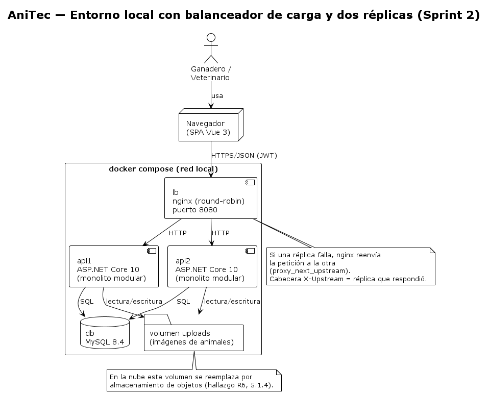
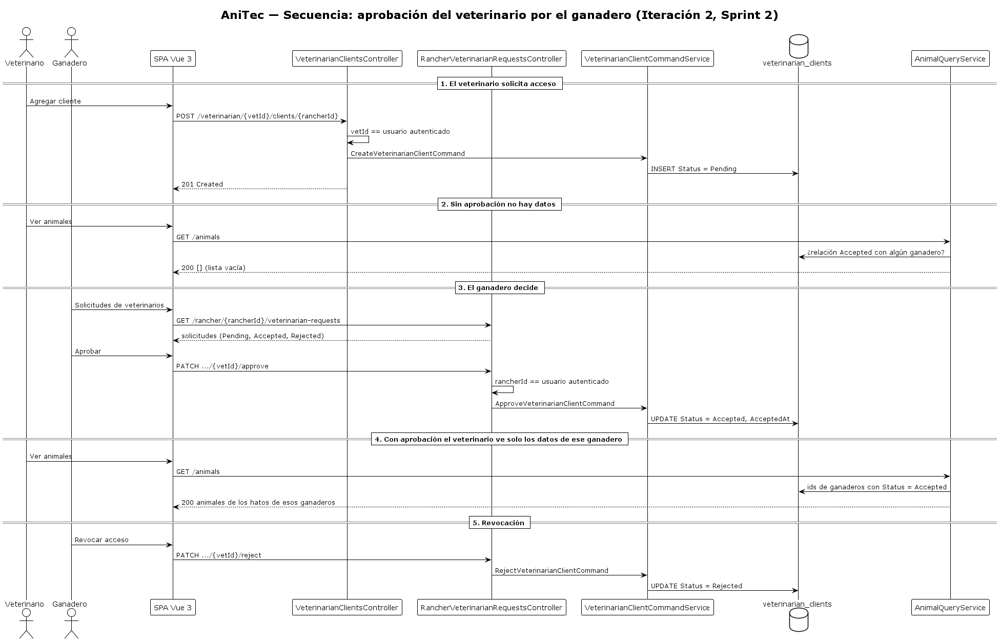
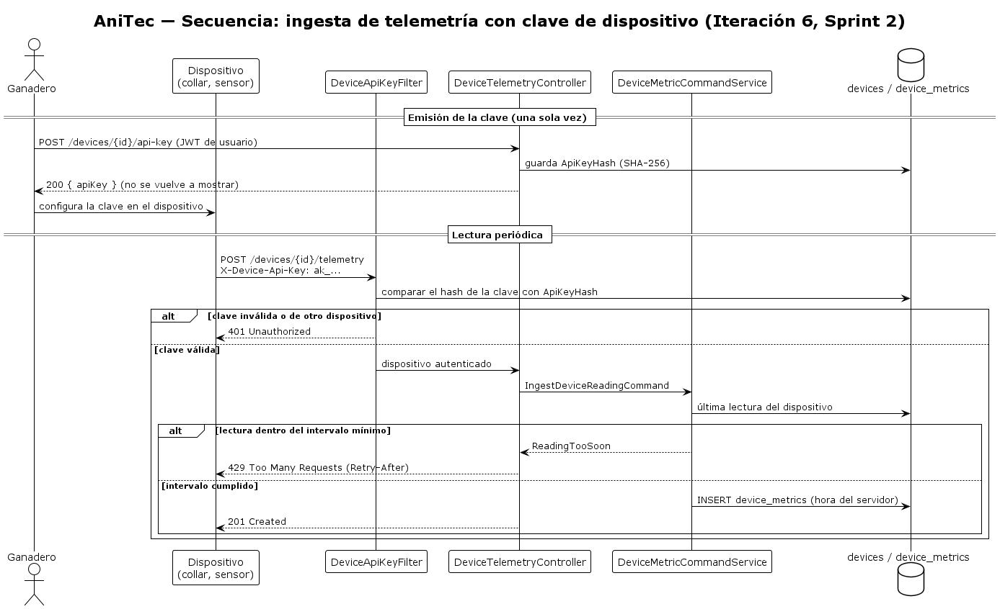

# 5.3.2. Sprint 2

El Sprint 2 es el primero que lleva a código las iteraciones de diseño del capítulo IV. Su objetivo fue **que cada usuario vea solo los datos que le corresponden y que el sistema soporte más de una instancia**: implementar la autorización por recurso y la aprobación del veterinario por el ganadero (iteración 2, QAS-08), la ingesta de telemetría autenticada con una clave por dispositivo (iteración 6, QAS-11) y un entorno local con balanceador de carga y dos réplicas del backend, que responde a la retroalimentación de la TB1. Además se corrigieron dos pendientes del Sprint 1: los testimonios y cifras de la landing page y los archivos que no debían estar en el repositorio del backend.

El periodo cubierto va del 26/10/2026 al 08/11/2026 <!-- PLACEHOLDER: confirmar la fecha de cierre del Sprint 2 (se asumió la semana previa al Avance 3) -->. Todo el trabajo de este Sprint se verificó en un entorno local con Docker Compose; **todavía no se desplegó en Render ni en Aiven**, y los Sprints 3 y 4 continuarán con las iteraciones 3, 5 y 7.

## 5.3.2.1. Sprint Backlog 2

El Sprint reúne las User Stories de acceso a los datos según el rol y del flujo de aprobación veterinario–ganadero (US-013, US-014, US-023, US-071, US-072 y US-073) y la de consulta de métricas IoT (US-059), que ahora puede alimentarse desde un dispositivo autenticado. A ellas se suman tareas de corrección y de infraestructura que no dependen de una historia: la landing page (US-050, del Sprint 1), el entorno con balanceador de carga y las pruebas. El total comprometido es de **27 Story Points** (valores del Product Backlog, sección 3.4). Las Technical Stories atendidas son TS-028 (autorización de mínimo privilegio, sin el registro de auditoría), TS-010 (telemetría, todavía dentro del monolito) y TS-030 (pruebas de seguridad).

<div align="center">
  <!-- PLACEHOLDER: captura del tablero de Trello del Sprint 2 -->
  
  <p><i><b>Fuente</b>: Tablero del Sprint 2 en Trello.</i></p>
</div>

**URL pública del tablero:** <!-- PLACEHOLDER: URL pública del tablero de Trello del Sprint 2 -->

### User Stories del Sprint

| # Orden | User Story Id | Título | Descripción | Story Points (1 / 2 / 3 / 5 / 8) |
|---|---|---|---|---|
| 1 | US-013 | Consultar animales según rol | Como usuario, quiero ver únicamente animales permitidos para proteger información de propietarios. | 3 |
| 2 | US-014 | Visualizar registros sanitarios | Como usuario autorizado, quiero revisar eventos sanitarios visibles para mi rol. | 3 |
| 3 | US-023 | Solicitar acceso sanitario | Como veterinario, quiero solicitar acceso para atender a un ganadero cuando el propietario lo apruebe. | 5 |
| 4 | US-071 | Aprobar o rechazar acceso | Como propietario, quiero definir alcance y duración de una solicitud para controlar mis datos. | 5 |
| 5 | US-073 | Consultar pacientes autorizados | Como veterinario, quiero ver únicamente clientes y animales autorizados para no mezclar información. | 3 |
| 6 | US-072 | Revocar acceso | Como propietario, quiero revocar un acceso para impedir nuevas consultas o modificaciones. | 3 |
| 7 | US-059 | Consultar métricas IoT | Como usuario autorizado, quiero consultar lecturas recientes de un dispositivo. | 5 |

Total comprometido: **27 Story Points**. El alcance de US-071 se acotó: el ganadero aprueba o rechaza, pero todavía no define el alcance ni la duración del acceso (solo existe "aprobado" o "no aprobado"). US-059 se cubre en el lado de la ingesta (las lecturas llegan desde un dispositivo autenticado); la vista de lecturas ya existía.

### Tabla de control de estado

Las horas son estimaciones del equipo para cada tarea. Los estados siguen la escala To-do / In-Process / To-Review / Done. Las tareas continúan la numeración del Sprint 1.

| Sprint # | Sprint 2 | | | | | | |
|---|---|---|---|---|---|---|---|
| **User Story** | | **Work-Item / Task** | | | | | |
| **Id** | **Title** | **Id** | **Title** | **Description** | **Estimation (Hours)** | **Assigned To** | **Status** |
| US-050 | Consultar casos ilustrativos | T-19 | Reformular cifras y testimonios de la landing | Corrige la tarea T-07 del Sprint 1: reemplaza los testimonios con nombres y fotos, las cifras de usuarios, calificaciones, porcentajes y superlativos por casos ilustrativos rotulados y datos verificables del producto (es/en). | 4 | Castro Picón, Manuel Fernando Joao | Done |
| US-050 | Consultar casos ilustrativos | T-20 | Retirar videos y fotos del equipo anterior | Quita los dos videos de YouTube del equipo anterior de la página Nosotros y las fotos que ya no se usan. | 2 | Castro Picón, Manuel Fernando Joao | Done |
| — | (Restricción: calidad del repositorio) | T-21 | Excluir imágenes subidas y archivos generados | `.gitignore` y `.dockerignore` del backend; se quitan del índice las imágenes de `wwwroot/uploads` y los `*.feature.cs`. | 1 | Melgarejo Quiroz, Josep Eliu | Done |
| US-013, US-014 | Consultar animales según rol; Visualizar registros sanitarios | T-22 | Filtrar los datos por propietario | Animales, eventos sanitarios, registros financieros y actividades se devuelven según el usuario autenticado; las escrituras de animales, eventos, registros y actividades verifican la propiedad; los tableros y la lista de clientes exigen que el id de la ruta sea el del usuario. | 6 | Melgarejo Quiroz, Josep Eliu | Done |
| US-023, US-071, US-072 | Solicitar, aprobar y revocar acceso | T-23 | Flujo de aprobación del veterinario | Estados Pending, Accepted y Rejected; endpoints para que el ganadero consulte, apruebe, rechace o revoque; migración de auditoría de la relación. | 5 | Melgarejo Quiroz, Josep Eliu | Done |
| — | (Restricción: seguridad) | T-24 | CORS por origen y `username` único | Política CORS leída de la configuración y índice único de `users.username`. | 2 | Baldeon Vivar, Santiago Armando | Done |
| US-023, US-071, US-073 | Solicitar y aprobar acceso; Consultar pacientes autorizados | T-25 | Pantalla de solicitudes y ajustes del veterinario | Vista de solicitudes del ganadero, estado "pendiente" y cancelación en las pantallas del veterinario, conteos de animales que entrega el servidor. | 6 | Castro Picón, Manuel Fernando Joao | Done |
| US-059 | Consultar métricas IoT | T-26 | Clave de API e ingesta de telemetría | Clave por dispositivo almacenada como hash SHA-256, filtro de autenticación del dispositivo, endpoint de telemetría e intervalo mínimo entre lecturas comprobado contra las lecturas almacenadas. | 6 | Baldeon Vivar, Santiago Armando | Done |
| US-059 | Consultar métricas IoT | T-27 | Generación de la clave de API en el frontend | Botón en el tablero IoT que muestra la clave una sola vez. | 2 | Castro Picón, Manuel Fernando Joao | Done |
| — | (Restricción: escalabilidad, TB1) | T-28 | Balanceador y dos réplicas con Docker Compose | `docker-compose.yml`, nginx con round-robin, endpoint `/health` y volumen compartido de imágenes. | 4 | Melgarejo Quiroz, Josep Eliu | Done |
| US-013, US-014, US-023, US-071, US-072 | Autorización y aprobación | T-29 | Pruebas de autorización y aprobación | `ResourceAuthorization.feature`, `VeterinarianAccessApproval.feature` y pruebas de los servicios de consulta. | 5 | Baldeon Vivar, Santiago Armando | Done |
| US-059 | Consultar métricas IoT | T-30 | Pruebas de telemetría y de nombre de usuario | `DeviceTelemetry.feature`, `DeviceReadingInterval.feature` y pruebas de registro con nombre duplicado. | 3 | Baldeon Vivar, Santiago Armando | Done |
| — | (Restricción: calidad) | T-31 | Verificación de punta a punta | Recorrido con el entorno Compose: aislamiento entre usuarios, aprobación, telemetría, CORS, balanceo y caída de una réplica. Encontró tres defectos que se corrigieron (ver "Defectos hallados en la verificación"). | 4 | Melgarejo Quiroz, Josep Eliu | Done |
| — | (Restricción: documentación) | T-32 | Documentar el Sprint 2 | Redactar la sección 5.3.2, los diagramas de fragmento y las decisiones derivadas de la TB1. | 6 | Castro Picón, Manuel Fernando Joao | Done |
| — | (Restricción: documentación) | T-33 | Actualizar el informe | Registro de versiones, conclusiones, estado de las iteraciones 2 y 6, índice y Performance Report. | 3 | Baldeon Vivar, Santiago Armando | Done |

**Resumen de horas por integrante** (suma de las tareas asignadas): Castro Picón, 20 h; Melgarejo Quiroz, 20 h; Baldeon Vivar, 19 h. Total estimado: 59 h.

**Resumen de estados:** las 15 tareas del Sprint están en Done.

### Decisiones derivadas de la retroalimentación de la TB1

En la TB1 el profesor aceptó el monolito modular, pero señaló que con varias localidades de ganado enviando peticiones una sola instancia es un punto de falla, y que esperaba ver balanceadores de carga y API Gateways. En este Sprint se respondió así:

**Estilos de arquitectura por tipo.** El profesor clasifica los estilos en tres tipos; AniTec los declara así:

| Tipo | Estilo en AniTec hoy | Evolución prevista |
|---|---|---|
| Estructura | Monolito modular con capas DDD (Domain, Application, Infrastructure, Interfaces) por bounded context. | Subscriptions como servicio independiente (Sprint 3); el resto sigue modular. |
| Comunicación | REST sobre HTTPS con JSON (cliente–servidor), sin sesión en el servidor (JWT). | API Gateway delante de los servicios (Sprint 3); eventos entre servicios no se implementan en este ciclo. |
| Despliegue | Contenedores Docker; hoy Render y Aiven en producción y, en local, Docker Compose con balanceador y dos réplicas. | Despliegue en nube (sección 5.4). |

**Prioridad de los drivers frente al producto.** La confidencialidad (QAS-08) se priorizó primero porque AniTec guarda datos sanitarios y financieros de productores y la revisión del código mostró que cualquier usuario autenticado podía leerlos de otro propietario llamando a la API. La comunicación con dispositivos (QAS-11) se priorizó después porque el producto integra dispositivos de campo y hasta ahora solo un usuario humano podía registrar lecturas. La disponibilidad bajo carga (retroalimentación de la TB1) se aborda con réplicas detrás de un balanceador. El rendimiento y la modificabilidad no se priorizaron en este Sprint y quedan como riesgo: no se midió el tiempo de respuesta ni la capacidad de carga.

**Balanceador y réplicas en este Sprint, gateway en el siguiente.** El balanceador no depende del gateway, así que se implementó ahora con nginx delante de dos réplicas del monolito, como en la solución que el profesor dibujó en clase (balanceador antes del API Gateway). Escalar horizontalmente es viable porque el backend no guarda sesión (JWT); el único estado local eran las imágenes subidas, que en Compose se comparten con un volumen y en la nube pasarán a almacenamiento de objetos (hallazgo R6). El API Gateway con YARP y el Subscriptions Service se implementan en el Sprint 3.

**Diferencias entre el diseño del capítulo IV y la implementación.** Al implementar se encontraron cinco diferencias, que se documentan en lugar de reescribir el capítulo IV:

1. La iteración 2 suponía leer la identidad de los *claims* de `HttpContext.User`. AniTec valida el JWT en su propio middleware y guarda el usuario en `HttpContext.Items["User"]`, por lo que la identidad se toma de ahí.
2. La iteración 6 proponía un `AuthenticationHandler` de ASP.NET Core. Como el proyecto no usa ese mecanismo, la clave de dispositivo se valida con un filtro de autorización propio (`DeviceApiKeyFilter`) coherente con el atributo `[Authorize]` del proyecto.
3. Los endpoints de aprobación se diseñaron bajo `/veterinarian/{id}/clients/{rancherId}`. Esa ruta está protegida para el rol veterinario, así que se ubicaron bajo `/rancher/{rancherId}/veterinarian-requests`, junto con un `GET` nuevo que el diseño no incluía y que la pantalla del ganadero necesita.
4. El diseño solo filtraba las lecturas. Se comprobó que el mismo problema existía en los tableros de analíticas y en las escrituras, así que también se protegieron.
5. La iteración 6 proponía el limitador de frecuencia nativo de ASP.NET Core (`AddRateLimiter`). Se implementó primero así y la verificación con dos réplicas mostró que su ventana vive en la memoria de cada réplica: una segunda lectura inmediata pasaba si el balanceador la enviaba a la otra réplica. El intervalo mínimo se comprueba ahora contra la última lectura guardada en la base de datos, que comparten todas las réplicas.

**Corrección de la tarea T-07 del Sprint 1.** La tarea T-07 figuraba como terminada en el Sprint 1, pero al revisar el código de la landing page se encontró que seguía mostrando cifras de usuarios, calificaciones, porcentajes de mejora y testimonios con nombres y fotos que no tenían respaldo. La corrección se hizo en este Sprint (tarea T-19) y quedó verificada en la página publicada solo cuando se despliegue la landing.

**Defectos hallados en la verificación.** El recorrido con el entorno Compose (sección 5.3.2.4) se ejecutó varias veces y encontró tres defectos que las pruebas a nivel de servicio no detectaron. Se corrigieron en ramas `fix/*` y se volvió a ejecutar el recorrido completo (48 de 48 verificaciones superadas en la última ejecución):

| Defecto | Causa | Corrección |
|---|---|---|
| Un veterinario que llamaba a un endpoint de ganadero recibía 500 en lugar de 403. | `AuthorizeAttribute` devolvía `ForbidResult`, que exige un esquema de autenticación de ASP.NET que el proyecto no registra. | Devuelve una respuesta 403 directa (`fix/forbidden-status-code`, con pruebas del atributo). |
| El límite de una lectura por intervalo no se cumplía con dos réplicas, y los intentos con clave inválida consumían el intervalo del dispositivo. | El limitador nativo guarda su ventana en memoria de cada réplica y se evaluaba antes de validar la clave. | El intervalo se comprueba contra la última lectura almacenada, después de autenticar al dispositivo (`fix/telemetry-shared-interval`, `DeviceReadingInterval.feature`). |
| Al detener una réplica, algunas peticiones tardaban varios segundos. | nginx esperaba el tiempo de conexión por defecto a una réplica que ya no existía. | `proxy_connect_timeout 2s` y reenvío a la otra réplica (`feature/docker-compose-load-balancer`). |

La clave de dispositivo se guarda además con SHA-256 y no con BCrypt (`fix/device-key-hashing`): la clave tiene 256 bits aleatorios y no puede adivinarse, y un hash lento en cada lectura no aporta protección. Esa decisión no debe copiarse a las contraseñas de usuario, que sí necesitan un hash lento.

**Limitaciones y brechas conocidas del Sprint.**

- Los listados de hatos y corrales y los de dispositivos y métricas todavía no se filtran por propietario; la brecha está identificada y no se cerró en este Sprint.
- El servidor sella la hora de cada lectura de telemetría; un dispositivo no puede enviar la hora de medición, por lo que todavía no se admiten lecturas acumuladas sin conexión.
- El intervalo mínimo se comprueba con una consulta a la tabla de lecturas: con miles de dispositivos convendría un caché compartido (por ejemplo Redis), que no se incorporó en este ciclo.
- La landing page todavía describe capacidades que no están implementadas (alertas automáticas, acceso móvil y funcionamiento sin conexión). Se revisaron las cifras y los testimonios, no el resto del contenido funcional.
- No hay pruebas automatizadas a nivel HTTP; los comportamientos de la API se verificaron a mano en el entorno Compose (sección 5.3.2.4).
- Al desplegar en Render, `Database.Migrate()` creará el índice único de `username`: si la base de Aiven tiene nombres duplicados, el servicio no arrancará hasta que se corrijan.

## 5.3.2.2. Development Evidence for Sprint Review

El Sprint se desarrolló con GitFlow: cada funcionalidad nace de `develop` en una rama propia y vuelve a `develop` con una fusión sin avance rápido. Los commits siguen Conventional Commits. La tabla incluye los commits de implementación de los tres repositorios de código; los de pruebas se listan en 5.3.2.3 y los del informe se registran en el repositorio `anitec-report`.

| Repository | Branch | Commit<br>Id | Commit<br>Message | Commit Message Body | Committed<br>on (Date) |
|---|---|---|---|---|---|
| anitec-backend | chore/gitignore-cleanup | `4fccd87` | `chore: stop tracking uploaded images and generated Reqnroll files` | Uploaded animal images, the generated *.feature.cs files and the test report folder were committed by mistake in b009c70. They are now ignored and removed from the index; the files stay on disk and the feature code is regenerated on build. | 26/10/2026 |
| anitec-backend | feature/resource-authorization | `6c86724` | `feat(clients): expose accepted rancher ids and veterinarian client statuses` | Adds the GetAcceptedRancherIdsByVeterinarianIdQuery, the status constants (Pending, Accepted, Rejected) and a repository lookup by rancher, plus the HttpContext.GetCaller() extension and the CallerContext record that carry the identity of the authenticated user to the query services. | 26/10/2026 |
| anitec-backend | feature/resource-authorization | `ae1bd5a` | `feat(security): filter data by ownership and approved relationships (QAS-08)` | Animals, health events, financial records and farm activities are now returned according to the authenticated caller: a rancher sees its own herds and a veterinarian only the ranchers that accepted it. Write operations on animals, health events, financial records and activities check ownership, the dashboards and the veterinarian client list require the route id to match the caller. | 26/10/2026 |
| anitec-backend | feature/veterinarian-approval-flow | `1dc09f4` | `feat(clients): require rancher approval before a veterinarian sees any data` | A veterinarian request now starts as Pending. The rancher can approve, reject or revoke it through the new /api/v1/rancher/{rancherId}/veterinarian-requests endpoints, and a veterinarian may ask again after a rejection. VeterinarianClient is auditable (migration AddVeterinarianClientAudit) and the development seeder includes a pending request. | 26/10/2026 |
| anitec-backend | feature/cors-allowed-origins | `d7ac254` | `feat(security): restrict CORS to the configured frontend origins` | Replaces the allow-all policy with Cors:AllowedOrigins (SPA on Render, GitHub Pages and the local Vite server). The list can be overridden with Cors__AllowedOrigins__N environment variables. | 26/10/2026 |
| anitec-backend | feature/unique-username | `d971051` | `feat(iam): enforce unique usernames with a database index` | Adds the unique index i_x_users_username (migration AddUsernameUniqueIndex). When two sign-ups race past the duplicate check, the rejected insert is reported as UsernameAlreadyTaken instead of a generic database error. | 26/10/2026 |
| anitec-backend | feature/device-api-key-telemetry | `5838ad2` | `feat(devices): issue hashed API keys for physical devices` | Devices gain ApiKeyHash (migration AddDeviceApiKeyHash). IssueDeviceApiKeyCommand creates a 256-bit random key, stores only its BCrypt hash and returns the key once; AuthenticateDeviceQuery verifies a key for a device. | 26/10/2026 |
| anitec-backend | feature/device-api-key-telemetry | `9e7aec5` | `feat(devices): ingest telemetry with a device API key and rate limiting (QAS-11)` | POST /api/v1/devices/{deviceId}/telemetry authenticates the device with the X-Device-Api-Key header through DeviceApiKeyFilter, reuses IDeviceMetricCommandService and is limited to one reading per device and interval (Telemetry:MinIntervalSeconds, 429 otherwise). POST /api/v1/devices/{id}/api-key lets the owner rancher issue or rotate the key. | 26/10/2026 |
| anitec-backend | feature/docker-compose-load-balancer | `e0c6b68` | `feat(devops): run two API replicas behind an nginx load balancer with Docker Compose` | docker-compose.yml starts MySQL 8.4, two replicas of the API and nginx with round-robin balancing, a shared volume for uploaded images and a /health endpoint used by the health checks. The second replica waits for the first one, which applies the migrations. nginx forwards the request to the other replica when one fails (answers TB1 feedback about load balancing and horizontal scaling). | 26/10/2026 |
| anitec-backend | fix/forbidden-status-code | `85d7249` | `fix(iam): answer 403 instead of 500 when the role cannot use an endpoint` | AuthorizeAttribute returned a ForbidResult, which needs an authentication scheme that AniTec does not register, so every role mismatch ended in a 500. It now returns an ObjectResult with status 403. | 26/10/2026 |
| anitec-backend | fix/device-key-hashing | `fd8dcad` | `fix(devices): hash device API keys with SHA-256 and partition the rate limit by key` | A device key has 256 random bits, so a fast hash is enough and keeps the per-request check cheap. The rate limit window is now per device and per key presented, so requests with a wrong key no longer use up the interval of the real device. | 26/10/2026 |
| anitec-backend | fix/telemetry-shared-interval | `316740b` | `fix(telemetry): enforce the reading interval against stored readings` | The in-memory rate limiter kept one window per replica, so a second reading could pass when the balancer sent it to the other replica. The minimum interval is now checked against the last stored reading of the device, which all replicas share, and the server stamps the time of reception. | 26/10/2026 |
| anitec-backend | develop | `804f2de` | `fix(metrics): use the inherited context in DeviceMetricRepository` | Removes the CS9107 warning introduced by the latest-reading query. | 26/10/2026 |
| anitec-frontend | feature/veterinarian-approval-ui | `df07c51` | `feat(clients): let ranchers approve or reject veterinarian access requests` | Adds the Veterinarian requests view (/rancher/veterinarian-requests) with approve, reject and revoke actions. The veterinarian screens now treat only accepted relationships as clients, show pending requests with a cancel action and use the animal counts returned by the server for ranchers that are not clients yet. | 26/10/2026 |
| anitec-frontend | feature/device-api-key-ui | `ff1360c` | `feat(devices): let ranchers generate the API key of a device` | The IoT dashboard gets an API key action for ranchers. The key returned by POST /devices/{id}/api-key is shown once with a copy button and the header the device must send, and rotating it asks for confirmation. | 26/10/2026 |
| anitec-landing-page | fix/illustrative-cases-landing | `12ddc55` | `fix: replace unverifiable claims with illustrative cases and verifiable facts` | The landing still showed invented user counts, ratings, percentages, superlatives, 24/7 support and testimonials with fictitious names and photos (US-050). Testimonials become labelled fictional scenarios without photos or stars, numeric claims become verifiable product facts, the metrics section is presented as product goals, and the previous team's YouTube videos are removed from the About page. | 26/10/2026 |
| anitec-landing-page | fix/illustrative-cases-landing | `15bc79c` | `fix: remove literal line breaks from translated stat labels` |  | 26/10/2026 |
| anitec-landing-page | chore/remove-legacy-team-assets | `fda3fcb` | `chore: remove unused photos of the previous team and of fictitious testimonial authors` | The About page now lists only the current team and the testimonial cards became fictional scenarios without photos, so these images are no longer referenced anywhere. | 26/10/2026 |

Además de los commits de implementación, `develop` registra las fusiones de cada rama. El análisis de colaboración se presenta en 5.3.2.7.

## 5.3.2.3. Testing Suite Evidence for Sprint Review

El proyecto `Anitec.Platform.Tests` pasó de 48 a **96 pruebas**, todas superadas. Las nuevas se escribieron con xUnit y Reqnroll sobre repositorios en memoria y verifican la lógica a nivel de servicio y del filtro de autorización.

| Archivo `.feature` | User Stories y escenario de calidad | Escenarios |
|---|---|---|
| `ResourceAuthorization.feature` | US-013, US-014, US-073, QAS-08 | 9 |
| `VeterinarianAccessApproval.feature` | US-023, US-071, US-072 | 9 |
| `DeviceTelemetry.feature` | US-059, QAS-11 | 10 |
| `DeviceReadingInterval.feature` | US-059, QAS-11 | 4 |

Se agregaron además pruebas unitarias de las consultas de propiedad y de visibilidad (`AnimalQueryServiceTests`), pruebas de `AuthorizeAttribute` (rol permitido, rol no permitido y usuario ausente) y dos pruebas de registro de usuarios (carrera entre dos altas con el mismo nombre y falla genérica de base de datos).

### Archivo `.feature` de autorización por recurso (US-013, US-014, US-073)

```gherkin
Feature: Authorization by resource ownership
  As a rancher or a veterinarian
  I want the server to return only the data that belongs to me or that I was authorized to see
  So that nobody can read the information of another owner by calling the API directly (QAS-08, US-013, US-014, US-073)

  Background:
    Given the rancher "Ana" with id 1 owns the herd "Los Alamos" with 2 animals
    And the rancher "Luis" with id 2 owns the herd "El Molino" with 3 animals

  Scenario: A rancher only sees the animals of its own herds
    When user 1 with role "Rancher" lists the animals
    Then 2 animals are returned

  Scenario: A rancher cannot read the detail of an animal of another rancher
    When user 1 with role "Rancher" asks for an animal of rancher 2
    Then the animal is not found

  Scenario: A veterinarian without a relationship sees no animals
    When user 10 with role "Veterinarian" lists the animals
    Then 0 animals are returned

  Scenario Outline: A relationship that is not accepted gives no access
    Given veterinarian 10 has a "<status>" relationship with rancher 1
    When user 10 with role "Veterinarian" lists the animals
    Then 0 animals are returned

    Examples:
      | status   |
      | Pending  |
      | Rejected |

  Scenario: An accepted relationship gives access only to the animals of that rancher
    Given veterinarian 10 has a "Accepted" relationship with rancher 1
    When user 10 with role "Veterinarian" lists the animals
    Then 2 animals are returned

  Scenario: The owner keeps seeing the health events registered by the veterinarian
    Given veterinarian 10 has a "Accepted" relationship with rancher 1
    And a health event exists for an animal of rancher 1
    Then user 1 with role "Rancher" sees 1 health events
    And user 10 with role "Veterinarian" sees 1 health events
    And user 2 with role "Rancher" sees 0 health events

  Scenario: A veterinarian loses access to the health events when the relationship is not accepted
    Given veterinarian 10 has a "Pending" relationship with rancher 1
    And a health event exists for an animal of rancher 1
    Then user 10 with role "Veterinarian" sees 0 health events

  Scenario: Financial records are private to the rancher that owns them
    Given a financial record exists for rancher 1
    Then user 1 with role "Rancher" sees 1 financial records
    And user 2 with role "Rancher" sees 0 financial records
    And user 10 with role "Veterinarian" sees 0 financial records

  Scenario: A rancher cannot register animals in the herd of another rancher
    Then user 1 with role "Rancher" does not own the herd of rancher 2
    And user 1 with role "Rancher" owns its own herd
```

### Archivo `.feature` de aprobación del veterinario (US-023, US-071, US-072)

```gherkin
Feature: Veterinarian access approval
  As a rancher
  I want to decide which veterinarians can see my herds and clinical history
  So that nobody reads my data without my explicit approval (US-023, US-071, US-072)

  Scenario: A veterinarian request starts as pending
    When veterinarian 10 requests access to rancher 1
    Then the request is saved with the status "Pending"
    And the request has no acceptance date

  Scenario: The rancher approves a pending request
    Given veterinarian 10 requested access to rancher 1
    When rancher 1 approves the request of veterinarian 10
    Then the request has the status "Accepted"
    And the request has an acceptance date

  Scenario: The rancher rejects a pending request
    Given veterinarian 10 requested access to rancher 1
    When rancher 1 rejects the request of veterinarian 10
    Then the request has the status "Rejected"

  Scenario: The rancher revokes the access of an accepted veterinarian
    Given veterinarian 10 requested access to rancher 1
    And rancher 1 approves the request of veterinarian 10
    When rancher 1 rejects the request of veterinarian 10
    Then the request has the status "Rejected"
    And the request has no acceptance date

  Scenario: A veterinarian cannot ask twice while the request is open
    Given veterinarian 10 requested access to rancher 1
    When veterinarian 10 requests access to rancher 1
    Then the operation fails with the error "VeterinarianClientAlreadyExists"

  Scenario: A veterinarian can ask again after a rejection
    Given veterinarian 10 requested access to rancher 1
    And rancher 1 rejects the request of veterinarian 10
    When veterinarian 10 requests access to rancher 1
    Then the request has the status "Pending"

  Scenario: A rejected request cannot be approved without a new request
    Given veterinarian 10 requested access to rancher 1
    And rancher 1 rejects the request of veterinarian 10
    When rancher 1 approves the request of veterinarian 10
    Then the operation fails with the error "VeterinarianClientNotPending"

  Scenario: Approving a request that does not exist fails
    When rancher 1 approves the request of veterinarian 99
    Then the operation fails with the error "VeterinarianClientNotFound"

  Scenario: Only an approved request opens the data of the rancher
    Given veterinarian 10 requested access to rancher 1
    Then the rancher 1 data is not visible to veterinarian 10
    When rancher 1 approves the request of veterinarian 10
    Then the rancher 1 data is visible to veterinarian 10
```

### Archivos `.feature` de telemetría de dispositivos (US-059)

```gherkin
Feature: Device authentication for telemetry ingestion
  As a rancher that installs a field device
  I want the device to authenticate with its own API key
  So that readings are accepted only from the device they claim to come from (QAS-11, US-058, US-059)

  Background:
    Given a device named "Collar Luna" exists
    And a device named "Balanza Los Alamos" exists

  Scenario: Issuing a key returns it once and stores only its hash
    When an API key is issued for "Collar Luna"
    Then the key starts with "ak_"
    And the stored value for "Collar Luna" is a SHA-256 hash and not the key

  Scenario: A valid key authenticates the device
    Given an API key was issued for "Collar Luna"
    When "Collar Luna" authenticates with its key
    Then the device is authenticated

  Scenario: A wrong key is rejected
    Given an API key was issued for "Collar Luna"
    When "Collar Luna" authenticates with the key "ak_not-the-key"
    Then the device is rejected

  Scenario: The key of another device is rejected
    Given an API key was issued for "Collar Luna"
    And an API key was issued for "Balanza Los Alamos"
    When "Collar Luna" authenticates with the key of "Balanza Los Alamos"
    Then the device is rejected

  Scenario: A device without a key cannot authenticate
    When "Collar Luna" authenticates with the key "ak_anything"
    Then the device is rejected

  Scenario: Issuing a new key invalidates the previous one
    Given an API key was issued for "Collar Luna"
    And a new API key is issued for "Collar Luna"
    When "Collar Luna" authenticates with its first key
    Then the device is rejected

  Scenario: Issuing a key for an unknown device fails
    When an API key is issued for the device with id 999
    Then issuing the key fails because the device does not exist

  Scenario: The HTTP filter accepts a request with a valid key for its device
    Given an API key was issued for "Collar Luna"
    When a telemetry request for "Collar Luna" carries its key in the "X-Device-Api-Key" header
    Then the request is authorized as "Collar Luna"

  Scenario: The HTTP filter rejects a request without the header
    Given an API key was issued for "Collar Luna"
    When a telemetry request for "Collar Luna" carries no key
    Then the request is rejected with status 401

  Scenario: The HTTP filter rejects a key sent to the route of another device
    Given an API key was issued for "Collar Luna"
    When a telemetry request for "Balanza Los Alamos" carries the key of "Collar Luna"
    Then the request is rejected with status 401
```

```gherkin
Feature: Minimum interval between device readings
  As the platform that runs on limited compute
  I want each device to send at most one reading per interval
  So that a device stuck in a retry loop cannot exhaust the service, whichever replica receives it (QAS-11, US-059)

  Background:
    Given the minimum interval between readings is 60 seconds
    And a device with id 7 sent a reading of 38.5 at 10:00:00

  Scenario: A reading inside the interval is rejected
    When the device with id 7 sends a reading of 38.7 at 10:00:30
    Then the reading is rejected because it came too soon
    And the device with id 7 has 1 stored readings

  Scenario: A reading after the interval is stored
    When the device with id 7 sends a reading of 38.7 at 10:01:00
    Then the reading is stored
    And the device with id 7 has 2 stored readings

  Scenario: The interval is counted per device
    When the device with id 8 sends a reading of 20.1 at 10:00:05
    Then the reading is stored

  Scenario: The first reading of a device is always stored
    When the device with id 9 sends a reading of 19.0 at 10:00:05
    Then the reading is stored
```

### Resultado de la ejecución

```text
Correctas! - Con error:     0, Superado:    96, Omitido:     0, Total:    96, Duración: 5 s - Anitec.Platform.Tests.dll (net10.0)
```

<div align="center">
  <!-- PLACEHOLDER: captura de la terminal con la ejecución de `dotnet test` (96 pruebas superadas) -->
  
  <p><i><b>Fuente</b>: Ejecución de <code>dotnet test</code> en <code>anitec-backend</code>.</i></p>
</div>

### Commits de pruebas

| Repository | Branch | Commit<br>Id | Commit<br>Message | Commit Message Body | Committed<br>on (Date) |
|---|---|---|---|---|---|
| anitec-backend | feature/resource-authorization | `6b4bf0c` | `test: cover resource authorization with Gherkin scenarios and query service tests` | Adds ResourceAuthorization.feature (10 scenarios) with in-memory repositories for herds, health events, financial records, activities and veterinarian clients, and unit tests for the ownership and visibility queries. | 26/10/2026 |
| anitec-backend | feature/veterinarian-approval-flow | `9273253` | `test: cover the veterinarian access approval flow` | Adds VeterinarianAccessApproval.feature with 9 scenarios: pending by default, approve, reject, revoke, duplicate request, request after rejection and visibility only after approval. | 26/10/2026 |
| anitec-backend | feature/unique-username | `7f03a9c` | `test: cover a concurrent duplicate sign-up and a generic database failure` |  | 26/10/2026 |
| anitec-backend | feature/device-api-key-telemetry | `f0d4b48` | `test: cover device API key issuance, authentication and the HTTP filter` | Adds DeviceTelemetry.feature with 10 scenarios that include the authorization filter running on a DefaultHttpContext. | 26/10/2026 |
| anitec-backend | fix/forbidden-status-code | `20441a0` | `test: cover the unauthorized, forbidden and allowed outcomes of AuthorizeAttribute` |  | 26/10/2026 |

### Alcance y límites

Las pruebas cubren ahora cinco de los doce bounded contexts (Shared, Iam, Livestock, Clients y Devices, más la consulta de Sanitary, Financial y Activities a través de los escenarios de autorización). Siguen siendo pruebas de servicio, no de la API HTTP, con repositorios en memoria: no validan el esquema MySQL real, la política CORS ni la respuesta HTTP 429 de la telemetría, que se verificaron a mano en el entorno Compose (la regla del intervalo mínimo sí está cubierta por `DeviceReadingInterval.feature`). La cobertura de código sigue sin medirse.

## 5.3.2.4. Execution Evidence for Sprint Review

El sistema se ejecutó en el entorno local con Docker Compose (MySQL 8.4, dos réplicas del backend y nginx en el puerto 8080). Los usuarios de demostración se cargan porque el entorno corre en `Development`. A continuación se resumen las verificaciones realizadas con `curl` sobre el balanceador; los valores sensibles (claves de dispositivo y tokens) se acortan.

El recorrido lo ejecutó el script `verify.py` (no versionado: usa las credenciales de demostración del entorno `Development`) contra `http://localhost:8080`, la dirección del balanceador. Cada línea es una comprobación y su resultado real en la última ejecución:

```text
=== 1. Balanceador: las peticiones se reparten entre las dos réplicas
OK    el balanceador responde 200 en /health
OK    las dos réplicas atienden peticiones -> 172.19.0.3:8080, 172.19.0.4:8080

=== 2. Autorización por recurso (QAS-08): listados
OK    cada ganadero ve solo sus animales
OK    veterinaria ve los animales de ganadero y maria -> 8 = 5 + 3
OK    vetpedro solo ve los de jose (maria está pendiente) -> 4 = 4
OK    vetlucia ve los de rosa
OK    ganadero no puede leer el animal de maria por id -> GET /animals/3 -> 404
OK    vetpedro (relación pendiente) no puede leer el animal de maria -> -> 404
OK    veterinaria (relación aceptada) sí puede leer el animal de maria -> -> 200

=== 2b. Autorización por recurso: otros recursos
OK    los eventos sanitarios de cada ganadero no se mezclan
OK    la veterinaria ve los eventos de sus dos clientes -> 3 = 2 + 1
OK    los registros financieros son privados -> ganadero 3, maria 2
OK    un veterinario no puede usar el módulo financiero -> status 403
OK    las actividades son del propietario
OK    el tablero de otro ganadero responde 403 -> -> 403
OK    el propio tablero responde 200 -> -> 200
OK    un veterinario no puede leer los clientes de otro -> -> 403

=== 3. Escrituras sobre recursos ajenos
OK    ganadero no puede borrar el animal de maria -> -> 404
OK    ganadero no puede registrar un animal en el hato de maria -> -> 404
OK    ganadero no puede crear un registro financiero a nombre de maria -> -> 404
OK    ganadero no puede cambiar el estado de animales de maria en lote -> -> 404

=== 4. Aprobación del veterinario por el ganadero
OK    maria ve la solicitud pendiente de vetpedro
OK    un veterinario no puede aprobarse a sí mismo -> -> 403
OK    otro ganadero no puede aprobar la solicitud de maria -> -> 403
OK    maria aprueba la solicitud -> -> 200 Accepted
OK    tras aprobar, vetpedro ve también los animales de maria -> 7 = 4 + 3
OK    maria revoca el acceso -> -> 200
OK    tras revocar, vetpedro vuelve a ver solo los de jose -> 4
OK    vetpedro puede volver a solicitar acceso tras el rechazo -> -> 201 Pending
OK    no puede duplicar una solicitud abierta -> -> 409

=== 5. Telemetría de dispositivos (QAS-11)
OK    otro ganadero no puede emitir la clave del dispositivo -> -> 404
OK    el dueño emite la clave del dispositivo
OK    sin clave la telemetría se rechaza -> -> 401
OK    con una clave incorrecta se rechaza -> -> 401
OK    la clave de otro dispositivo se rechaza -> -> 401
OK    con la clave correcta se registra la lectura -> -> 201 id=12
OK    una segunda lectura inmediata se limita (429) -> -> 429
OK    pasado el intervalo vuelve a aceptarse -> -> 201
OK    la última lectura queda disponible para el usuario -> -> {'id': 13, 'deviceId': 1, 'type': 'Temperatura', 'value': 38.9, 'unit': 'C', 'recordedAt': '2026-10-26T06:00:02.639992'}
OK    al rotar la clave la anterior deja de funcionar -> -> 401

=== 6. CORS por origen
OK    origen http://localhost:5173 permitido
OK    origen https://anitec-frontend-cve3.onrender.com permitido
OK    origen http://sitio-ajeno.example no permitido

=== 7. Nombre de usuario único
OK    registrar un nombre ya usado falla -> -> 409 {'type': 'https://tools.ietf.org/html/rfc9110#section-15.5.10', 'title': 'UsernameAlreadyTaken', 'status': 409, 'detail': 'UsernameAlreadyTaken', 'instance': '/api/v1/authentication/sign-up', 'traceId': '00-9892ed4b30b3871b4543ba38d099f566-f7e5978ed34bd17c-00'}
OK    existe el índice único en la base de datos

=== 8. Réplicas sin estado: token y archivos compartidos
OK    el mismo token se acepta en las dos réplicas -> 6/6 respuestas 200 desde ['172.19.0.3:8080', '172.19.0.4:8080']
OK    la imagen subida se sirve desde las dos réplicas -> [200, 200, 200, 200] desde ['172.19.0.3:8080', '172.19.0.4:8080']

=== 9. Caída de una réplica
OK    con api1 detenida el servicio sigue respondiendo -> 8/8 respuestas 200 atendidas por ['172.19.0.4:8080']
Resumen: 48 de 48 verificaciones superadas
```

Evidencia del balanceo: seis peticiones consecutivas a `/health` fueron atendidas alternando las dos réplicas, según la cabecera `X-Upstream`:

```text
['172.19.0.3:8080', '172.19.0.4:8080', '172.19.0.3:8080', '172.19.0.4:8080', '172.19.0.3:8080', '172.19.0.4:8080']
```

Con `api1` detenida, ocho peticiones seguidas devolvieron 200 y todas las atendió `api2`. El script vuelve a iniciar `api1` al terminar.

<div align="center">
  <!-- PLACEHOLDER: captura de Docker Desktop con los contenedores db, api1, api2 y lb en ejecución -->
  
  <p><i><b>Fuente</b>: Docker Desktop.</i></p>
</div>

<div align="center">
  <!-- PLACEHOLDER: captura de Postman con las solicitudes de aprobación del veterinario -->
  
  <p><i><b>Fuente</b>: Postman.</i></p>
</div>

<div align="center">
  <!-- PLACEHOLDER: captura de Postman con la ingesta de telemetría (401, 201 y 429) -->
  
  <p><i><b>Fuente</b>: Postman.</i></p>
</div>

**Enlace al video de demostración del Sprint 2:** <!-- PLACEHOLDER: reemplazar por la URL del video (YouTube) que muestre la aprobación del veterinario, la telemetría y el balanceo --> `https://youtu.be/xxxxxxxxxxx`

### Diagramas de los cambios del Sprint

Solo se muestran los fragmentos que cambian en este Sprint.

<div align="center">
  
  <p><i><b>Fuente</b>: <code>CodeDiagrams/5-3-2-sprint-2/compose-load-balancer.puml</code>.</i></p>
</div>

<div align="center">
  
  <p><i><b>Fuente</b>: <code>CodeDiagrams/5-3-2-sprint-2/sequence-veterinarian-approval.puml</code>.</i></p>
</div>

<div align="center">
  
  <p><i><b>Fuente</b>: <code>CodeDiagrams/5-3-2-sprint-2/sequence-device-telemetry.puml</code>.</i></p>
</div>

## 5.3.2.5. Microservices Documentation Evidence for Sprint Review

Los endpoints se documentan con OpenAPI mediante Swashbuckle. En el entorno Compose, Swagger está en `http://localhost:8080/swagger`. La tabla incluye los endpoints creados o modificados en este Sprint.

| Método y ruta | Rol / autenticación | Descripción | Respuestas |
|---|---|---|---|
| `GET /api/v1/rancher/{rancherId}/veterinarian-requests` | Rancher (solo su propio id) | Lista las solicitudes de acceso de veterinarios (Pending, Accepted, Rejected). Es nuevo. | 200, 403 |
| `PATCH /api/v1/rancher/{rancherId}/veterinarian-requests/{veterinarianId}/approve` | Rancher (solo su propio id) | Aprueba la solicitud: el veterinario pasa a ver los datos del ganadero. Es nuevo. | 200, 403, 404 |
| `PATCH /api/v1/rancher/{rancherId}/veterinarian-requests/{veterinarianId}/reject` | Rancher (solo su propio id) | Rechaza o revoca el acceso. Es nuevo. | 200, 403, 404 |
| `POST /api/v1/veterinarian/{veterinarianId}/clients/{rancherId}` | Veterinarian (solo su propio id) | Crea una solicitud en estado Pending; tras un rechazo permite volver a solicitar. Modificado. | 201, 403, 409 |
| `GET /api/v1/veterinarian/{veterinarianId}/clients` | Veterinarian (solo su propio id) | Lista las relaciones del veterinario con el conteo de animales calculado por el servidor. Modificado. | 200, 403 |
| `GET /api/v1/animals`, `GET /api/v1/animals/{id}` y las escrituras de animales | Rancher / Veterinarian | Devuelve solo los animales del usuario o de los ganaderos que lo aprobaron; 404 si el recurso no es suyo. Modificado. | 200, 404 |
| `GET /api/v1/health-events`, `/financial-records`, `/farm-events` | Según módulo | Mismo filtro por propietario o por relación aprobada; el módulo financiero responde 403 a un veterinario. Modificado. | 200, 403, 404 |
| `GET /api/v1/analytics/ranchers/{rancherId}/dashboard` y resúmenes | Rancher / Veterinarian | El id de la ruta debe ser el del usuario; el tablero del veterinario cuenta solo clientes aceptados. Modificado. | 200, 403 |
| `POST /api/v1/devices/{id}/api-key` | Rancher (dueño del hato o animal del dispositivo) | Emite o rota la clave de API del dispositivo; se muestra una sola vez. Es nuevo. | 200, 404 |
| `POST /api/v1/devices/{deviceId}/telemetry` | Dispositivo (cabecera `X-Device-Api-Key`) | Registra una lectura (tipo, valor, unidad); el servidor sella la hora. Es nuevo. | 201, 400, 401, 429 |
| `GET /health` | Sin autenticación | Comprobación de salud usada por Docker y el balanceador. Es nuevo. | 200 |

### Ejemplos de petición y respuesta

**Listar las solicitudes de veterinarios (ganadera María).**

```http
GET /api/v1/rancher/3/veterinarian-requests
Authorization: Bearer <token>
```

```json
[
  { "id": 5, "veterinarianId": 5, "rancherId": 3, "veterinarianName": "Dr. Pedro Ramirez",
    "status": "Pending", "requestedAt": "2026-10-26T05:59:51.060244", "acceptedAt": null },
  { "id": 2, "veterinarianId": 2, "rancherId": 3, "veterinarianName": "Dra. Ana Lopez",
    "status": "Accepted", "requestedAt": "2026-10-06T05:44:35.862409", "acceptedAt": "2026-10-06T05:44:35.862409" }
]
```

**Aprobar la solicitud.** Con el token de María la respuesta es 200 y el estado pasa a `Accepted`. Con el token del propio veterinario es 403:

```http
PATCH /api/v1/rancher/3/veterinarian-requests/5/approve
Authorization: Bearer <token del veterinario>
```

```json
{ "title": "Forbidden", "status": 403, "detail": "The role of the authenticated user cannot use this resource." }
```

**Emitir la clave de un dispositivo (ganadero dueño).** La clave completa solo aparece en esta respuesta; aquí se acortó:

```json
{ "deviceId": 1, "apiKey": "ak_AW1V...", "header": "X-Device-Api-Key" }
```

**Enviar una lectura.** Sin cabecera, 401; con la clave, 201; una segunda lectura dentro del intervalo (10 s en el entorno local, 60 s en producción), 429 con la cabecera `Retry-After`:

```http
POST /api/v1/devices/1/telemetry
X-Device-Api-Key: ak_...
Content-Type: application/json

{ "type": "Temperatura", "value": 38.6, "unit": "C" }
```

```json
{ "id": 14, "deviceId": 1, "type": "Temperatura", "value": 38.6, "unit": "C", "recordedAt": "2026-10-26T06:01:22.397441Z" }
```

```json
{ "message": "The device already sent a reading in the last interval." }
```

<div align="center">
  <!-- PLACEHOLDER: captura de Swagger con los endpoints de solicitudes de veterinarios y de telemetría -->
  
  <p><i><b>Fuente</b>: Swagger del backend en el entorno Compose.</i></p>
</div>

## 5.3.2.6. Software Deployment Evidence for Sprint Review

En este Sprint el despliegue consistió en definir y probar un entorno reproducible con varias instancias; **no se actualizó el despliegue de producción en Render ni en Aiven**.

| Elemento | Detalle |
|---|---|
| Orquestación | `docker-compose.yml` en la raíz de `anitec-backend`. |
| Servicios | `db` (MySQL 8.4), `api1` y `api2` (imagen construida con el `Dockerfile` existente) y `lb` (nginx). |
| Balanceo | `nginx/nginx.conf`: `upstream` con las dos réplicas en round-robin, `proxy_connect_timeout 2s` y `proxy_next_upstream` para reenviar la petición a la otra réplica si una falla, y la cabecera `X-Upstream` con la réplica que respondió. |
| Migraciones | La primera réplica aplica las migraciones al iniciar; la segunda espera a que esté sana (`/health`). |
| Estado compartido | Volumen `uploads` para las imágenes de animales. |
| Configuración | Variables en `.env` (copiado de `.env.example`, que no contiene secretos); el archivo `.env` no se versiona. |

Pasos para levantar el entorno:

```bash
cp .env.example .env
docker compose up --build
curl -i http://localhost:8080/health
```

**Pasos pendientes para producción (se harán al integrar el Sprint):** fusionar `develop` en `main`, comprobar antes que no haya nombres de usuario duplicados en la base de Aiven (la migración `AddUsernameUniqueIndex` crea un índice único), definir en Render las variables `Cors__AllowedOrigins__N` solo si cambian los dominios y volver a desplegar el backend, el frontend y la landing page.

<div align="center">
  <!-- PLACEHOLDER: captura de la ejecución de `docker compose up` -->
  
  <p><i><b>Fuente</b>: Terminal.</i></p>
</div>

## 5.3.2.7. Team Collaboration Insights during Sprint

Los tres integrantes participaron en las tareas del Sprint según la tabla de control de estado de 5.3.2.1: Castro Picón en la landing page, el frontend y la documentación del Sprint; Melgarejo Quiroz en el backend de autorización, el flujo de aprobación, el entorno Compose y la verificación; y Baldeon Vivar en la seguridad de CORS y nombres de usuario, la telemetría y las pruebas. El repositorio de cada producto usa ahora la rama `develop` y ramas por funcionalidad (`feature/*`, `fix/*`, `chore/*`).

<div align="center">
  <!-- PLACEHOLDER: captura de los analíticos de colaboración de GitHub (Insights → Contributors) de los repositorios del Sprint 2 -->
  
  <p><i><b>Fuente</b>: GitHub Insights.</i></p>
</div>

## 5.3.2.8. Kanban Board --> Avance 3

<div align="center">
  <!-- PLACEHOLDER: captura final del tablero de Trello al cierre del Sprint 2 -->
  
  <p><i><b>Fuente</b>: Tablero del Sprint 2 en Trello.</i></p>
</div>

**Revisión del objetivo:** el objetivo del Sprint se cumplió en el entorno local: las consultas devuelven solo los datos del propietario o del veterinario aprobado, el ganadero decide quién accede, un dispositivo con clave válida registra lecturas y el servicio continúa si una de las dos réplicas se detiene. Queda pendiente llevar estos cambios a producción y atender las brechas listadas en 5.3.2.1.

**Lecciones aprendidas:**

- Implementar reveló diferencias con el diseño (identidad en `HttpContext.Items`, ruta de los endpoints de aprobación, filtro propio para la clave de dispositivo) que solo se vieron leyendo el código en ejecución; conviene validar el diseño contra el código antes de la siguiente iteración.
- El filtrado en el servidor obligó a revisar el frontend, que filtraba en el cliente y asumía que todo cliente devuelto era un cliente aprobado.
- Las pruebas de servicio con repositorios en memoria no habrían detectado ninguno de los tres defectos de la verificación (403 que respondía 500, limitador por réplica y espera de conexión en el failover); la verificación de punta a punta con las dos réplicas sí. Conviene automatizarla en un sprint próximo.
- La revisión de la landing page mostró que una tarea marcada como terminada en el Sprint 1 no estaba reflejada en el código: la evidencia de cada tarea debe incluir el commit que la implementa.
