# 5.3.3. Sprint 3

El Sprint 3 lleva a código la iteración 3 del capítulo IV (extracción de servicios críticos y API Gateway). Su objetivo fue **que la suscripción y el pago de AniTec sean un servicio independiente, con su propia base de datos y detrás de un API Gateway, y que un pago de prueba real con Stripe quede registrado de punta a punta**. Además de construirlo y verificarlo en el entorno local con Docker Compose, el equipo lo desplegó en Azure (Azure Container Apps y Azure Database for MySQL), que es el primer despliegue en nube del proyecto.

El periodo cubierto va del 07/11/2026 al 19/11/2026; el estado que describe esta sección es el del **12/11/2026**. Todo lo que se afirma como verificado se ejecutó realmente en ese corte; lo que no se ejecutó se marca como diseñado o pendiente. Las claves de Stripe, el secreto del JWT y las cadenas de conexión no aparecen en ninguna parte de este informe ni de los repositorios: viven en variables de entorno, en archivos ignorados por Git y en los secretos de Azure.

## 5.3.3.1. Sprint Backlog 3

El Sprint reúne las cuatro User Stories del contexto de planes y pagos (US-060, US-061, US-062 y US-063) y las Technical Stories que las habilitan: TS-008 (extracción incremental de un bounded context), TS-025 (API Gateway y contratos versionados), TS-016 y TS-017 (integración de Stripe en backend y frontend) y TS-030 (pruebas de contrato y de seguridad). El escenario de calidad que gobierna el Sprint es QAS-09 (aislamiento de fallos del subsistema de facturación), y la restricción de nube pedida por el curso se atiende con el despliegue en Azure. El total comprometido es de **17 Story Points** (valores del Product Backlog, sección 3.4).

<div align="center">
  <!-- PLACEHOLDER: captura del tablero de Trello del Sprint 3 (lista Sprint Backlog con las 4 User Stories y lista To-do con las 13 tareas) -->
  <p><i><b>Fuente</b>: Tablero del Sprint 3 en Trello (captura pendiente de agregar por el equipo).</i></p>
</div>

**URL pública del tablero:** <!-- PLACEHOLDER: reemplazar por la URL pública del tablero del Sprint 3 en Trello --> `https://trello.com/b/xxxxxxxx/sprint-3-fundamentos`

### User Stories del Sprint

| # Orden | User Story Id | Título | Descripción | Story Points (1 / 2 / 3 / 5 / 8) |
|---|---|---|---|---|
| 1 | US-060 | Visualizar planes | Como usuario, quiero comparar planes para identificar una opción compatible con mi operación. | 3 |
| 2 | US-061 | Consultar suscripción activa | Como usuario, quiero conocer el estado y alcance de mi plan. | 3 |
| 3 | US-062 | Realizar pago de prueba | Como usuario, quiero recorrer un pago controlado para validar el flujo de suscripción. | 8 |
| 4 | US-063 | Consultar historial de pagos | Como usuario, quiero revisar los pagos asociados a mi cuenta. | 3 |

Total comprometido: **17 Story Points**. Alcance real de las historias: el pago es un cobro de prueba en el modo de prueba de Stripe (no se cobra dinero real), la suscripción se crea al confirmarse el pago y no existe todavía cancelación, renovación ni cambio de plan con prorrateo: si el usuario paga otro plan, la suscripción más reciente es la activa y la anterior se cierra. El límite de animales de cada plan se muestra, pero **no se aplica** al registrar animales (ya figuraba como pendiente en 4.3.3.2 y sigue pendiente).

### Tabla de control de estado

Las horas son estimaciones del equipo para cada tarea. Los estados siguen la escala To-do / In-Process / To-Review / Done. Las tareas continúan la numeración del Sprint 2.

| Sprint # | Sprint 3 | | | | | | |
|---|---|---|---|---|---|---|---|
| **User Story** | | **Work-Item / Task** | | | | | |
| **Id** | **Title** | **Id** | **Title** | **Description** | **Estimation (Hours)** | **Assigned To** | **Status** |
| — | (Restricción: gateway, TS-025) | T-40 | API Gateway con YARP | Proyecto `Anitec.Gateway`: rutas por prefijo, clúster del núcleo con reparto por turnos y comprobaciones de salud activas y pasivas, CORS, identificador de correlación, error documentado para versión no soportada, error JSON cuando un servicio no responde y `Dockerfile`. | 8 | Melgarejo Quiroz, Josep Eliu | Done |
| — | (Restricción: despliegue local) | T-41 | Compose con dos gateways y el servicio de suscripciones | `lb` hacia `gateway1` y `gateway2`, servicio `subscriptions`, segunda base de datos con usuario propio creada por un paso idempotente y `.env.example` sin secretos. | 5 | Melgarejo Quiroz, Josep Eliu | Done |
| — | (Restricción: migración de datos, TS-008) | T-42 | Retirar Subscriptions del núcleo y preparar la copia de datos | El núcleo deja de registrar, mapear y sembrar planes, suscripciones y pagos. Script de copia con verificación y archivo SQL de borrado manual; no hay migración que borre tablas. | 4 | Melgarejo Quiroz, Josep Eliu | Done |
| — | (Restricción: nube) | T-43 | Despliegue en Azure | Script `deploy/azure/deploy.sh`: grupo de recursos, Container Apps (gateway, núcleo y Subscriptions), Azure Database for MySQL, registro de imágenes, secretos de Azure y URLs. Verificado el 08/11 y el 12/11 (ver 5.3.3.6). | 8 | Melgarejo Quiroz, Josep Eliu | Done |
| US-060, US-061, US-063 | Visualizar planes; Consultar suscripción activa; Consultar historial de pagos | T-44 | Extraer el servicio de suscripciones | Proyecto `Anitec.Subscriptions` con su `DbContext`, migración inicial que crea las tres tablas y siembra los tres planes (49, 99 y 129 PEN), `Dockerfile` y `/health`. | 7 | Baldeon Vivar, Santiago Armando | Done |
| US-061, US-063 | Consultar suscripción activa; Consultar historial de pagos | T-45 | Autenticación por claims y propiedad de los recursos | El servicio valida el JWT por firma sin consultar la tabla de usuarios; la suscripción activa, los pagos y una suscripción por id responden 404 si no son del usuario (QAS-08); los endpoints de gestión de planes y `mock-checkout` solo existen en Development. | 4 | Baldeon Vivar, Santiago Armando | Done |
| US-062 | Realizar pago de prueba | T-46 | Stripe: pasarela, checkout y webhook firmado | `IPaymentGateway` con cliente de Stripe propio por instancia, claves y URLs de retorno por variables de entorno, webhook anónimo con firma verificada e idempotente, y `confirm` corregido como respaldo. | 8 | Baldeon Vivar, Santiago Armando | Done |
| US-060 a US-063 | Planes y pagos | T-47 | Pruebas de Subscriptions y del gateway | `Anitec.Subscriptions.Tests` y `Anitec.Gateway.Tests` (pruebas HTTP contra el servicio real y contra un gateway real frente a servidores simulados) y siete archivos `.feature` de Reqnroll. | 6 | Baldeon Vivar, Santiago Armando | Done |
| US-060, US-062 | Visualizar planes; Realizar pago de prueba | T-48 | Frontend: URL del gateway y estados del pago | El frontend habla solo con el gateway, la página de éxito distingue confirmado, en proceso y fallido (con reintento) y los errores de Stripe tienen mensaje propio en español e inglés. | 5 | Castro Picón, Manuel Fernando Joao | Done |
| US-060 | Visualizar planes | T-49 | Landing: precios y promesas reales | La página muestra los tres planes reales con su límite de animales y retira las promesas que el producto no cumple. | 3 | Castro Picón, Manuel Fernando Joao | Done |
| — | (Restricción: calidad) | T-50 | GitHub Actions: compilar, probar y construir imágenes | Flujo `.github/workflows/ci.yml` que compila la solución, corre las pruebas contra un MySQL descartable y construye las tres imágenes. **Escrito pero aún no ejecutado en GitHub.** | 3 | Castro Picón, Manuel Fernando Joao | To-Review |
| — | (Restricción: documentación) | T-51 | Documentar el Sprint 3 | Redactar la sección 5.3.3, los diagramas y las diferencias de diseño. | 8 | Castro Picón, Manuel Fernando Joao | To-Review |
| — | (Restricción: documentación) | T-52 | Actualizar el informe | Índice, registro de versiones, conclusiones, estado de la iteración 3, sección 5.4, Student Outcome y Performance Report. | 6 | Castro Picón, Manuel Fernando Joao | To-Review |

**Resumen de horas por integrante** (suma de las tareas asignadas): Melgarejo Quiroz, 25 h; Baldeon Vivar, 25 h; Castro Picón, 25 h. Total estimado: 75 h.

**Resumen de estados:** de las 13 tareas, 10 están en Done y 3 en To-Review (T-50 espera su primera ejecución en GitHub; T-51 y T-52 son esta documentación y la actualización del informe, pendientes de la revisión del equipo). La sección 5.3.3.2 lista los commits como están en los repositorios.

### Decisiones y diferencias con el diseño de la iteración 3

El capítulo IV queda como se entregó; las diferencias entre el diseño de 4.3.3 y lo que se implementó se documentan aquí.

**Qué se extrajo y por qué.** Subscriptions es el contexto con menos acoplamiento (4.3.3.2): ningún otro contexto lo referencia y no tiene claves foráneas hacia `users`. El acoplamiento que sí existía era el `AppDbContext` compartido, el middleware de identidad (que consultaba la tabla `users`) y el `Program.cs`. El servicio nuevo copia el núcleo mínimo (`IBaseRepository`, `IUnitOfWork`, `Result` y el manejo de errores) en lugar de referenciar el proyecto del núcleo; la duplicación es una decisión consciente para no tocar el núcleo y para que el servicio no tenga ninguna referencia a él.

**Diferencias entre el diseño y la implementación.**

1. **El balanceador va antes del gateway.** El diagrama de 4.3.3 muestra SPA → Gateway → Subscriptions. La implementación mantiene el nginx del Sprint 2 al frente (como en la solución que el profesor dibujó en clase) y balancea dos réplicas del gateway, que es un servicio sin estado. En Azure, el ingreso de Container Apps hace ese papel.
2. **El gateway no valida el token.** Como indica 4.3.3.5, reenvía `Authorization` sin modificarlo; el núcleo y Subscriptions lo validan con el mismo secreto. La consecuencia es que un token inválido llega hasta el servicio, que lo rechaza con 401; el gateway no lo detiene antes.
3. **Subscriptions valida por claims, no por middleware de identidad.** El núcleo guarda el usuario en `HttpContext.Items["User"]` consultando la base; el servicio nuevo toma `Sid`, `Role` y `Name` del token y no consulta `users`. Un usuario eliminado conserva un token válido hasta que vence (hasta 7 días) en este servicio: es una limitación conocida.
4. **Stripe ya existía parcialmente en el monolito.** Había un checkout y un `confirm` sin webhook y con la clave en una variable estática. Se reescribió detrás de `IPaymentGateway`, se añadió el webhook firmado e idempotente y `confirm` pasó a ser un respaldo. El webhook es la vía principal para registrar el pago.
5. **Los datos se copian, no se migran con EF.** El núcleo arranca con `Database.Migrate()`, y una migración que borrase las tablas de suscripciones las habría eliminado en producción antes de comprobar la copia. Por eso el borrado es un archivo SQL manual (`scripts/subscriptions-cutover/drop-core-subscriptions-tables.sql`) que se ejecuta solo con autorización y después de verificar la copia.
6. **El circuito de protección y la observabilidad distribuida quedan fuera.** El circuit breaker y los eventos entre servicios de 4.3.3 y 4.3.7 no se implementaron; corresponden al Sprint 4. El aislamiento de QAS-09 se logra con el límite de proceso, el error controlado y las comprobaciones de salud.
7. **En Azure el reparto del núcleo lo hace Azure.** El gateway mantiene dos destinos del núcleo (`api1` y `api2`) con la misma dirección interna; el reparto entre las dos réplicas lo hace el balanceador de Container Apps, no el gateway.

**Prioridad de los drivers.** QAS-09 y la extracción (TS-008) se priorizaron juntos, como pedía 4.3.3.2, y el gateway (TS-025) se construyó como medio para exponer los dos servicios con un solo punto de entrada. El trade-off del salto de red adicional se aceptó en el diseño y se midió en el entorno local: el núcleo respondió con mediana de 12,5 ms y percentil 95 de 15,3 ms con el gateway delante (40 peticiones), una medición de un solo entorno que no sustituye una prueba de carga.

**Defectos hallados en la verificación.** El recorrido de punta a punta (sección 5.3.3.4) encontró cuatro defectos que las pruebas de servicio no detectaron; los tres primeros se corrigieron y el último queda declarado:

| Defecto | Causa | Corrección |
|---|---|---|
| Con Subscriptions detenido, el núcleo y `/health` también respondían 502 ("no live upstreams"). | nginx contaba como fallo de un gateway cualquier 502 o 503 que el gateway devolvía por un servicio caído y sacaba los dos gateways de la rotación. | Solo los errores de conexión y los tiempos de espera cuentan como fallo (`fix/nginx-keep-gateways-in-rotation`). |
| Con un servicio detenido, cada llamada esperaba de 4 a 7 s antes de fallar. | YARP envía la petición a todos los destinos cuando ninguno está sano y, en Compose, el nombre de un contenedor detenido deja de resolverse. | El pipeline responde 503 de inmediato con el documento de error del gateway cuando no hay destino sano (`fix/gateway-fail-fast-unhealthy`). |
| Una reconstrucción de contenedores dejaba el balanceador apuntando a direcciones viejas de los gateways. | nginx resuelve los nombres de los servidores solo al iniciar. | Se reinicia `lb` tras recrear los gateways; queda en el README del backend. |
| Al detener una réplica del núcleo, entre 2 y 3 de las primeras peticiones responden 502. | El gateway no reintenta la petición contra la otra réplica cuando una falla. | **No corregido.** Medido: 2 de 150 peticiones con 502 y un máximo de 7,4 s en la última ejecución; reintentar solo las lecturas idempotentes queda como mejora. |

**Defectos del código heredado, corregidos al extraer.** La revisión del código de Subscriptions mostró que `confirm` aceptaba el pago con una condición que bastaba cumplir una de las dos partes (sesión completa o pagada) en lugar de ambas, que un rol no permitido devolvía 500 por `Forbid()`, que `mock-checkout` tomaba el usuario del cuerpo de la petición, que la suscripción activa y los pagos no comprobaban el dueño y que cualquier ganadero o veterinario podía crear, editar o borrar planes. Todo ello se corrigió en `feature/subscriptions-claims-auth` y `feature/stripe-checkout-webhook` y está cubierto por pruebas.

**Limitaciones y brechas conocidas del Sprint.**

- El límite de animales de los planes no se aplica al registrar animales.
- No hay cancelación de la suscripción, renovación ni prorrateo.
- El identificador del pago guarda el id de la sesión de Checkout (`cs_test_...`), no el del cobro (`pi_...`).
- Un token de un usuario eliminado sigue siendo válido en Subscriptions hasta su vencimiento.
- El gateway no valida el JWT ni reintenta contra otra réplica del núcleo si una cae.
- El Swagger de Subscriptions no se agrega al del núcleo: cada servicio publica el suyo.
- La referencia `Microsoft.OpenApi 2.4.1` genera la advertencia NU1903 al compilar; no se actualizó.
- Las imágenes que suben los usuarios se guardan en el disco de cada contenedor; en Azure no se comparten entre réplicas y se pierden al reiniciar (la solución, almacenamiento de objetos o Azure Files, no se implementó).
- El frontend no tiene pruebas automatizadas y su configuración de producción sigue apuntando a Render, donde el backend es el monolito anterior.
- La landing todavía describe capacidades que no están implementadas fuera de los precios (alertas automáticas, acceso móvil y funcionamiento sin conexión).
- El flujo de CI se escribió pero no se ha ejecutado en GitHub.

## 5.3.3.2. Development Evidence for Sprint Review

El Sprint se desarrolló con GitFlow: cada funcionalidad nace de `develop` en una rama propia y vuelve a `develop` con una fusión sin avance rápido; los commits siguen Conventional Commits. La tabla incluye los commits de implementación de los tres repositorios de código; los de pruebas se listan en 5.3.3.3 y los del informe se registran en `anitec-report`. Las fechas son las del repositorio. Los commits de las ramas se hicieron desde la cuenta de Git configurada en la máquina de desarrollo; la asignación de cada tarea al integrante que corresponde se refleja en la tabla de 5.3.3.1 y los integrantes confirmarán su participación en el Student Outcome.

| Repository | Branch | Commit<br>Id | Commit<br>Message | Commit Message Body | Committed<br>on (Date) |
|---|---|---|---|---|---|
| anitec-backend | feature/subscriptions-service-extraction | `9ae39bd` | `feat(subscriptions): extract the Subscriptions context into its own service` | Adds the Anitec.Subscriptions project with its own DbContext, an initial migration that creates plans, subscriptions and payments and seeds the three plans (49, 99 and 129 PEN), a Dockerfile and a /health endpoint. The service validates the JWT issued by the core by signature and reads the identity from the claims, without querying the users table. The secret has no default and must come from TokenSettings__Secret. | 07/11/2026 |
| anitec-backend | feature/subscriptions-claims-auth | `cf27c18` | `feat(subscriptions): authorize by owner using the claims of the token` | A user now sees only its own subscriptions and payments; the active subscription, the payment history and a subscription by id answer 404 when the resource belongs to someone else (QAS-08). The endpoints that create or change plans and subscriptions, and mock-checkout, answer 404 outside Development. | 07/11/2026 |
| anitec-backend | feature/stripe-checkout-webhook | `be78658` | `feat(subscriptions): checkout through a payment gateway with a signed webhook` | Moves Stripe behind IPaymentGateway with its own StripeClient. Adds POST /api/v1/subscriptions/stripe/webhook: anonymous but it only acts on events whose Stripe-Signature verifies against the raw body. A paid checkout.session.completed stores the subscription and the payment once; unique indexes make that hold when the webhook and the confirm endpoint arrive together. Confirm stays as a fallback and requires the session to be complete and paid. | 07/11/2026 |
| anitec-backend | feature/api-gateway-yarp | `e6d614e` | `feat(gateway): add the YARP API gateway in front of the core and Subscriptions` | Adds the Anitec.Gateway project. Subscription paths go to Subscriptions and everything else, including /uploads, goes to the core, balanced round robin with active and passive health checks. The gateway forwards Authorization untouched, adds X-Correlation-Id, answers a documented 400 for an API version other than v1, turns a service failure into a JSON problem that names the cluster and handles CORS once. | 07/11/2026 |
| anitec-backend | feature/compose-gateway-subscriptions | `711a5e9` | `feat(compose): route traffic through two gateways and add the Subscriptions service` | nginx now balances two YARP gateways, which send subscription routes to the Subscriptions service and everything else to the two core replicas. The service has its own database and MySQL user, created by an idempotent db-init step. Stripe keys come from the environment and may stay empty. | 08/11/2026 |
| anitec-backend | chore/remove-subscriptions-from-core | `05ec4d7` | `chore(core): remove Subscriptions from the core and add the data cutover scripts` | The core no longer registers, maps or seeds plans, subscriptions and payments, and drops the Stripe package. The tables are not dropped by a migration because the core migrates on startup. A script copies and checks the rows and a separate SQL file drops the tables by hand. | 08/11/2026 |
| anitec-backend | chore/github-actions-ci | `172a939` | `chore(ci): run build, tests and Docker image builds on GitHub Actions` | The workflow builds the solution, runs the core, Subscriptions and gateway tests against a throwaway MySQL service, uploads the results and builds the three images. It uses no secrets and publishes nothing. | 08/11/2026 |
| anitec-backend | fix/nginx-keep-gateways-in-rotation | `ab9272c` | `fix(nginx): keep healthy gateways in the rotation when a service behind them fails` | With 502 and 503 in proxy_next_upstream nginx counted every answer of the gateway as a gateway failure and took both gateways out of the rotation, so even /health answered 502. Only connection errors and timeouts now count as failures. | 08/11/2026 |
| anitec-backend | fix/gateway-fail-fast-unhealthy | `04c72ef` | `fix(gateway): answer at once when no destination of a cluster is healthy` | YARP sends the request to every destination when none is healthy, so a stopped service made each caller wait 4 to 7 s. The proxy pipeline now answers 503 with the problem document of the gateway immediately, and the active check brings the destination back. | 08/11/2026 |
| anitec-backend | chore/stack-verification-scripts | `7f47422` | `chore: add end-to-end verification script for the compose stack` | Checks routes, gateway contract, ownership and webhook rejection, and measures what a client sees when Subscriptions, one core replica or one gateway replica stop. | 08/11/2026 |
| anitec-backend | feature/azure-container-apps | `4e90ef8` | `chore(azure): add template and git ignore for the deployment secrets file` | The deployment secrets file is git-ignored; only a template without values is versioned. | 08/11/2026 |
| anitec-backend | feature/azure-container-apps | `ff57513` | `feat(azure): add deployment script for Container Apps and MySQL flexible server` | Subcommands for smoke test, infrastructure, images, database, apps, Stripe webhook secret, status and guarded destroy. Secrets are read from the git-ignored deploy/azure/.secrets.env and loaded into Azure secrets; nothing is printed. | 08/11/2026 |
| anitec-backend | feature/azure-container-apps | `e9761aa` | `fix(deploy): create MySQL in mexicocentral because eastus2 has no available SKUs` | eastus2 has no MySQL Flexible Server SKUs for this subscription; the database is created in mexicocentral and the apps stay in eastus2. | 08/11/2026 |
| anitec-backend | feature/azure-container-apps | `85ce35d` | `feat(subscriptions): log the reason why a Stripe webhook is rejected` | The webhook controller discarded the reason of a rejection. It now logs the reason, never the secret, the header or the body. | 12/11/2026 |
| anitec-frontend | feature/gateway-base-url | `a65cd92` | `feat(config): point the frontend at the API gateway` | The development configuration points to the gateway, which sends subscription paths to the Subscriptions service and everything else to the core. Production keeps the current backend until the gateway is deployed; the README explains how to switch and that the VITE values are embedded at build time. | 08/11/2026 |
| anitec-frontend | feature/subscription-flow-polish | `01d0dd3` | `feat(subscriptions): show clear payment states and errors` | The success page shows confirmed, in progress or failed states with a retry button instead of always saying the payment was confirmed. Payment errors are classified and each one has its own message in Spanish and English. The plans page no longer shows the internal Stripe price id. | 08/11/2026 |
| anitec-landing-page | fix/pricing-matches-real-plans | `7885b59` | `fix(pricing): show the real plans and remove promises the product does not keep` | The pricing section now shows the three plans of the Subscriptions service (Ganadero Basico S/ 49, Ganadero Pro S/ 99 and Veterinario Profesional S/ 129) with their animal limits and says that payments run in Stripe test mode. The claims of cancelling anytime, annual savings and automatic backup were removed. | 08/11/2026 |

`develop` registra además las fusiones de cada rama. En el momento del corte, ninguno de los commits de este Sprint se había publicado en GitHub: el equipo los subirá con `git push`, y los releases `v1.3.0` del backend y del frontend y `v1.2.0` de la landing page se preparan al cerrar el Sprint.

## 5.3.3.3. Testing Suite Evidence for Sprint Review

Las pruebas del Sprint se reparten en tres proyectos de pruebas. El de la plataforma conserva sus **141 pruebas del Sprint 2**, que siguen superadas después de retirar Subscriptions del núcleo; los dos proyectos nuevos son `Anitec.Subscriptions.Tests` y `Anitec.Gateway.Tests`. Las pruebas de Subscriptions se ejecutan por HTTP contra el servicio real con una pasarela de pago falsa, de modo que cubren la autorización, el contrato y la firma del webhook; las del gateway levantan el gateway real en memoria frente a tres servidores HTTP reales que hacen de dos réplicas del núcleo y de Subscriptions.

La verificación de la última ejecución (12/11/2026, `dotnet test` sobre `anitec-platform.sln`):

```text
Correctas! - Con error:     0, Superado:   141, Omitido:     0, Total:   141, Duración: 4 s  - Anitec.Platform.Tests.dll (net10.0)
Correctas! - Con error:     0, Superado:    83, Omitido:     1, Total:    84, Duración: 3 s  - Anitec.Subscriptions.Tests.dll (net10.0)
Correctas! - Con error:     0, Superado:    72, Omitido:     0, Total:    72, Duración: 52 s - Anitec.Gateway.Tests.dll (net10.0)
```

En total, **297 pruebas: 296 superadas y 1 omitida**. La omitida es la prueba de concurrencia que envía ocho webhooks de la misma sesión al mismo tiempo y solo corre contra un MySQL real (variable `SUBSCRIPTIONS_TEST_MYSQL`); en la ejecución estándar se omite y su resultado contra MySQL se verificó aparte en el entorno Compose (sección 5.3.3.4).

<div align="center">
  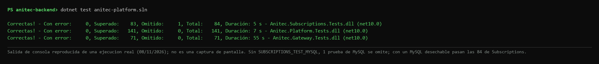
  <p><i><b>Fuente</b>: Salida de consola reproducida de una ejecución real de <code>dotnet test</code> en <code>anitec-backend</code> (no es una captura de pantalla).</i></p>
</div>

### Archivos `.feature` del Sprint

| Archivo | Escenarios | Qué describe |
|---|---|---|
| `SubscriptionPlans.feature` | 5 | Un usuario con sesión ve los planes con su precio (esquema de escenarios), y un visitante sin token, un token firmado con otro secreto, un token vencido o un rol desconocido no acceden (US-060). |
| `SubscriptionOwnership.feature` | 7 | Cada usuario ve su suscripción activa y su historial de pagos; otro usuario no ve la activa, ni el historial, ni abre una suscripción por id, y la lista solo muestra las suyas (US-061, US-063, QAS-08). |
| `StripeCheckout.feature` | 10 | El monto sale del plan y el comprador del token, un plan inexistente, sin claves de Stripe (503), Stripe inalcanzable (502), `confirm` de un pago confirmado, no pagado, de otro usuario, inexistente o abierto por otro servicio, y un plan mejor que cierra la suscripción anterior (US-062). |
| `StripeWebhook.feature` | 8 | Notificación firmada y pagada, la misma notificación entregada dos veces (se guarda una), firma falsificada, cuerpo alterado, sin firma, evento de otro tipo, checkout completo pero no pagado y sin secreto configurado (US-062). |
| `GatewayRouting.feature` | 5 | Las rutas de Subscriptions van a su servicio, el resto va al núcleo, las peticiones se reparten entre las dos réplicas, el webhook llega con su cuerpo y firma sin modificar y el token se reenvía sin validarse. |
| `GatewayContract.feature` | 6 | Identificador de correlación (se genera, se conserva, se reemplaza si está mal formado), versión no soportada con error documentado sin enrutar, versión soportada enrutada y respuesta propia de un servicio sin reemplazar (TS-025). |
| `ServiceIsolation.feature` | 5 | Con Subscriptions detenido solo sus rutas fallan y el núcleo sigue en 200; un servicio que falla su comprobación de salud no recibe tráfico y el error llega de inmediato; vuelve a funcionar al regresar; y una réplica del núcleo que falla sale de la rotación y vuelve (QAS-09). |

Total: 46 escenarios en siete archivos (algunos son esquemas de escenarios con varios ejemplos). Extracto del archivo de aislamiento:

```gherkin
Feature: A failing service does not drag down the others
  As an operator of the platform
  I want the failure of one service or of one replica to stay contained
  So that the rest of the system keeps answering (QAS-09)

  Background:
    Given the gateway is running with two replicas of the core and the Subscriptions service

  Scenario: When Subscriptions is down, only its routes fail and the core keeps answering
    Given the Subscriptions service stops
    When a client sends GET "/api/v1/subscription-plans" 4 times
    Then every answer is a problem document that names the "subscriptions" service
    And 20 requests to "/api/v1/animals" are all answered with status 200

  Scenario: A service that fails its health check receives no traffic and the caller gets the error at once
    Given the Subscriptions service reports itself as unhealthy
    And the gateway reports the service "subscriptions" as "Unhealthy"
    When a client sends GET "/api/v1/subscription-plans" once
    Then every answer is a problem document that names the "subscriptions" service
    And the Subscriptions service received nothing
    And 5 requests to "/api/v1/animals" are all answered with status 200
```

### Commits de pruebas

| Repository | Branch | Commit<br>Id | Commit<br>Message | Commit Message Body | Committed<br>on (Date) |
|---|---|---|---|---|---|
| anitec-backend | feature/stripe-checkout-webhook | `58958d1` | `test(subscriptions): cover authorization, checkout and the signed webhook` | Adds Anitec.Subscriptions.Tests with HTTP tests against the real API and a fake payment gateway: token validation, roles, 404 for resources of another user, development-only endpoints, checkout amount taken from the plan, confirm, duplicate, forged and tampered webhooks, unpaid and foreign sessions, and a plan change closing the previous subscription. | 07/11/2026 |
| anitec-backend | feature/api-gateway-yarp | `15adea9` | `test(gateway): cover routing, correlation, versions, CORS and fault isolation` | Adds Anitec.Gateway.Tests, which runs the real gateway in memory against three real HTTP servers standing in for two core replicas and Subscriptions. Includes QAS-09: with Subscriptions stopped its routes fail with a clear error while 20 requests to the core all succeed. | 07/11/2026 |
| anitec-backend | feature/subscriptions-tests | `94556d9` | `test: add Gherkin scenarios for Subscriptions and the gateway` | Reqnroll features describe the acceptance criteria of plans, ownership, the Stripe checkout and webhook, the routing and contract of the gateway, and the isolation of a failing service. The steps run against the real services in memory. | 08/11/2026 |

### Alcance y límites

Las pruebas verifican el contrato HTTP de cada servicio y el aislamiento a nivel de proceso simulado; no sustituyen la verificación en el entorno real. No cubren la integración con Stripe real (se probó a mano, sección 5.3.3.4), el comportamiento del balanceador nginx ni el despliegue en Azure. La cobertura de código sigue sin medirse y el frontend no tiene pruebas automatizadas.

## 5.3.3.4. Execution Evidence for Sprint Review

El sistema se ejecutó en tres escenarios: el entorno local con Docker Compose, un pago real de prueba en Stripe contra ese entorno y el entorno desplegado en Azure. Los scripts de verificación están versionados en `anitec-backend/scripts/verification/verify_stack.py`; usan las cuentas de demostración del entorno `Development` y por eso no se pueden ejecutar tal cual contra Azure, donde el núcleo usa la base real de Aiven.

### Verificación del entorno Compose (31 de 31 comprobaciones)

`verify_stack.py` ejecuta tres modos contra el balanceador (`http://localhost:8080`) y guarda un informe JSON. Resultado real de la última ejecución, del 08/11/2026:

```text
== base: routes, contract of the gateway, ownership, webhook ==
OK   two users sign in through lb -> gateway -> core
OK   /health through the load balancer -> 200
OK   /gateway/status lists every destination as Healthy
OK   plans with token -> 200 and the 3 seeded plans (49, 99, 129 PEN)
OK   the answer carries X-Correlation-Id
OK   a well-formed correlation id sent by the client is kept
OK   unsupported API version -> 400 with a documented error
OK   plans without token -> 401 (answer of Subscriptions)
OK   core route through the gateway (herds) -> 200
OK   another user's active subscription -> 404 (QAS-08)
OK   another user's payments -> 404 (QAS-08)
OK   own payments -> 200
OK   webhook without a valid signature -> 400
OK   webhook with a wrong signature -> 400
OK   the load balancer alternates between the two gateways

== isolation (QAS-09): Subscriptions stopped, core must keep answering ==
OK   core routes keep answering 200 while Subscriptions is down (60 of 60)
OK   /health keeps answering 200 (60 of 60)
OK   Subscriptions routes answer a controlled 502/503, never an unhandled error
OK   the error is a JSON problem that names the service
OK   the error carries a correlation id
OK   the plans route answers 200 again through the gateway (0.6 s after the container was healthy)

== replicas: one core replica and one gateway replica fail ==
OK   core replica api1 stopped: requests keep succeeding (failed 2 of 150)
OK   the gateway reports api1 as Unhealthy
OK   the gateway puts api1 back in rotation
OK   gateway replica gateway1 stopped: requests keep succeeding through gateway2 (100 of 100)
OK   both gateways answer again through the load balancer (3 s after gateway1 was healthy)

31 of 31 checks passed
```

(El resultado completo tiene además las comprobaciones de estado de cada contenedor; aquí se omiten las líneas que solo confirman que un contenedor volvió a estar sano.)

**QAS-09, medido.** Con el servicio de suscripciones detenido, 60 de 60 peticiones a una ruta del núcleo respondieron 200 (mediana de 14,9 ms, percentil 95 de 27,7 ms, máximo de 41,4 ms) y `/health` siguió en 200. Las rutas de Subscriptions respondieron un 502 o 503 controlado con un documento JSON que nombra el servicio y lleva el identificador de correlación. La mediana de esas respuestas de error tras detectar el fallo fue de 7,7 ms; la primera tardó hasta 6,6 s antes de la corrección del fallo rápido (sección 5.3.3.1). Al volver el contenedor, la ruta de planes respondió 200 de nuevo 0,6 s después de estar sano. La meta de 4.3.3.2 (0 % de degradación en los endpoints no relacionados) se cumple en el entorno local con un fallo simulado detenido el contenedor, **pero no se probó con un fallo del propio Stripe**.

**Réplicas.** Con una réplica del núcleo detenida, 148 de 150 peticiones respondieron 200 y 2 respondieron 502 (la primera falló en la petición 0); el gateway marcó la réplica como no sana y la devolvió a la rotación al volver. Con un gateway detenido, 100 de 100 respondieron 200 por el otro gateway (máximo de 2,0 s) y volvió a la rotación de nginx 3 s después de estar sano.

<div align="center">
  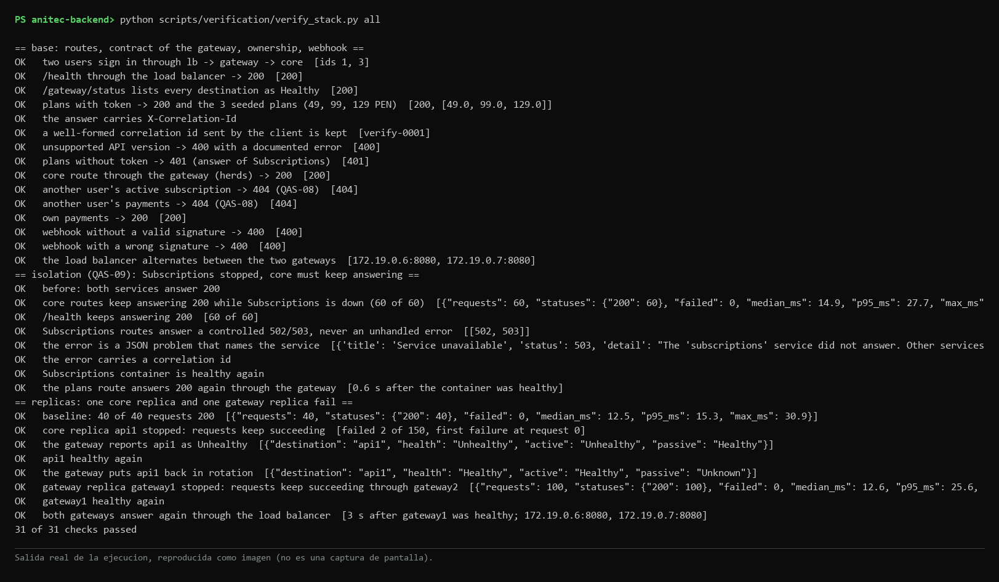
  <p><i><b>Fuente</b>: Salida de consola reproducida de una ejecución real (08/11/2026); no es una captura de pantalla.</i></p>
</div>

<div align="center">
  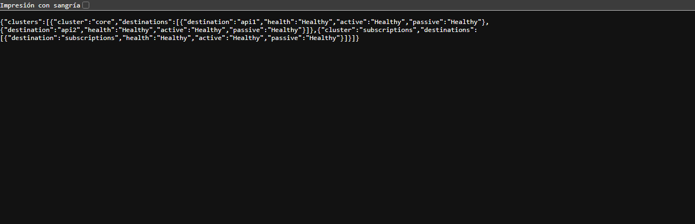
  <p><i><b>Fuente</b>: Captura de pantalla de <code>/gateway/status</code> en el entorno Compose: el núcleo (<code>api1</code> y <code>api2</code>) y <code>subscriptions</code> en estado <code>Healthy</code>.</i></p>
</div>

<div align="center">
  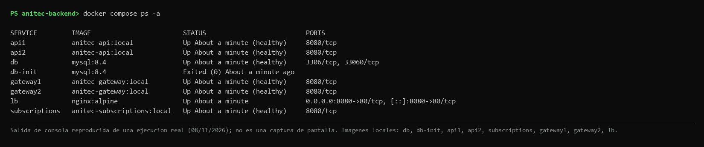
  <p><i><b>Fuente</b>: Salida de consola reproducida de <code>docker compose ps</code>; no es una captura de pantalla.</i></p>
</div>

### Frontend contra el entorno Compose

El frontend se construyó apuntando al gateway local y se verificó con un navegador sin cabeza (Microsoft Edge). Las capturas muestran los planes reales, el pago real de prueba confirmado y el comportamiento con el servicio de suscripciones detenido.

<div align="center">
  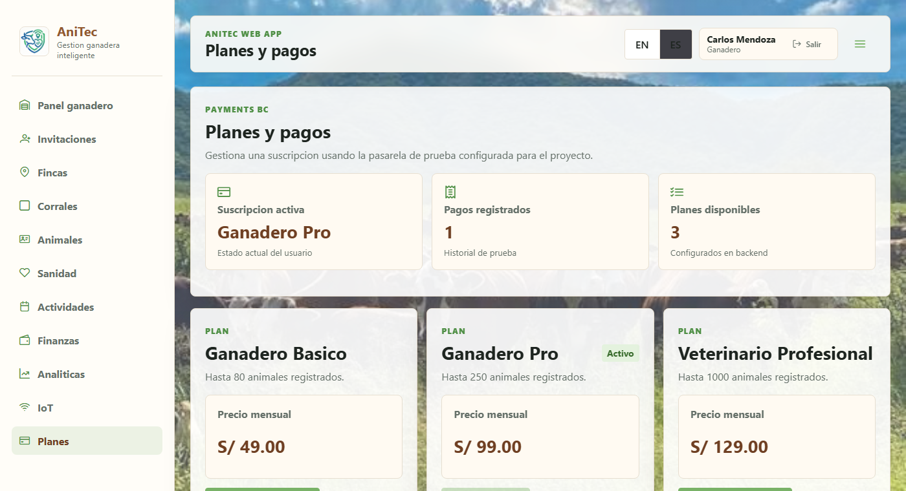
  <p><i><b>Fuente</b>: Captura de pantalla de la página de planes en el entorno Compose.</i></p>
</div>

<div align="center">
  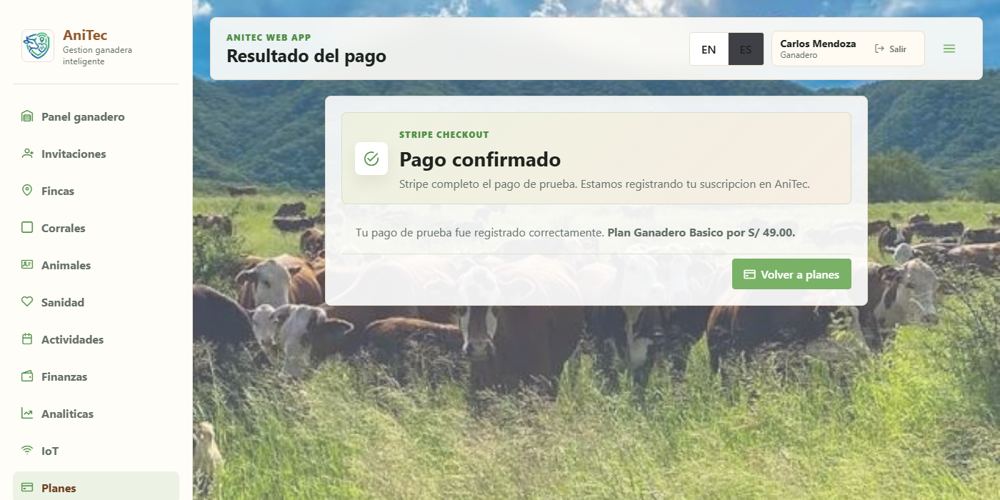
  <p><i><b>Fuente</b>: Captura de pantalla de la página de éxito tras un pago de prueba real contra el entorno Compose (webhook recibido con la CLI de Stripe).</i></p>
</div>

<div align="center">
  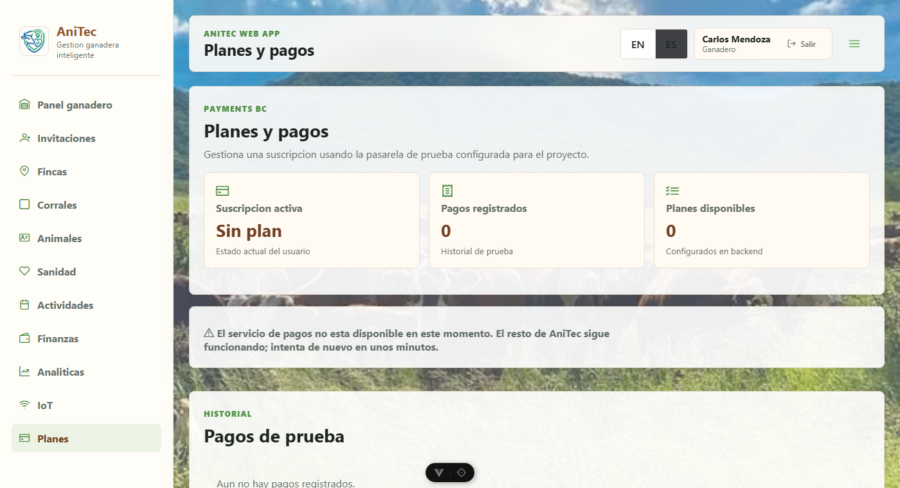
  <p><i><b>Fuente</b>: Captura de pantalla con el servicio de suscripciones detenido: la página muestra un mensaje claro y el resto del panel sigue disponible (QAS-09 visto desde el usuario).</i></p>
</div>

<div align="center">
  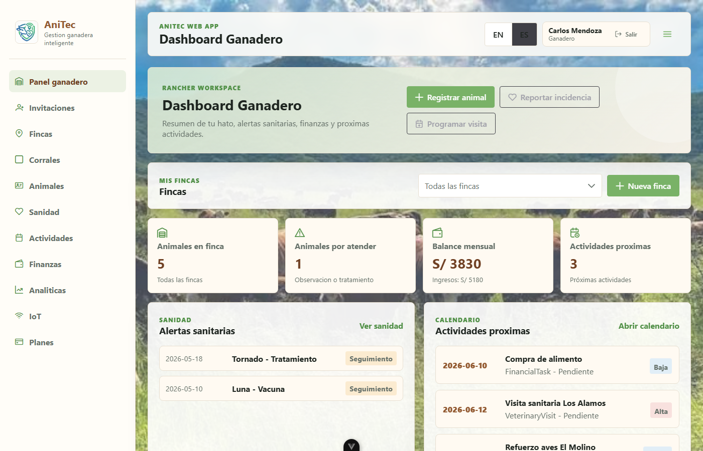
  <p><i><b>Fuente</b>: Captura de pantalla del panel del ganadero con el servicio de pagos detenido: los módulos del núcleo siguen respondiendo.</i></p>
</div>

<div align="center">
  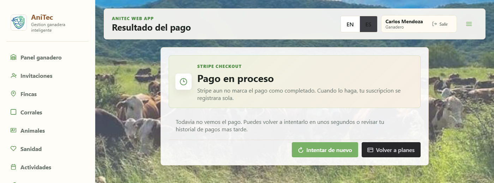
  <p><i><b>Fuente</b>: Captura de pantalla del estado <i>pago en proceso</i> con botón de reintento.</i></p>
</div>

<div align="center">
  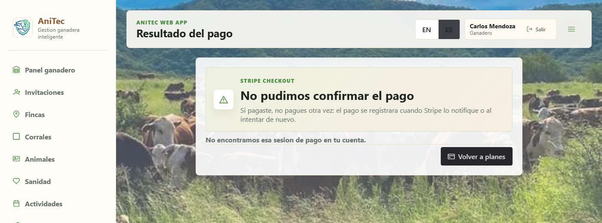
  <p><i><b>Fuente</b>: Captura de pantalla del error de sesión de pago no encontrada (404), con su propio mensaje.</i></p>
</div>

### Pago real de prueba con webhook (entorno Compose)

Con la CLI de Stripe (`stripe listen`) reenviando los eventos al balanceador local, se pagó un plan con la tarjeta de prueba de Stripe. El webhook firmado registró la suscripción y el pago una sola vez, y reenviar el mismo evento o llamar a `confirm` devolvió el mismo resultado sin duplicar (idempotencia). Un segundo usuario recibió 404 al consultar la suscripción activa y los pagos del primero.

<div align="center">
  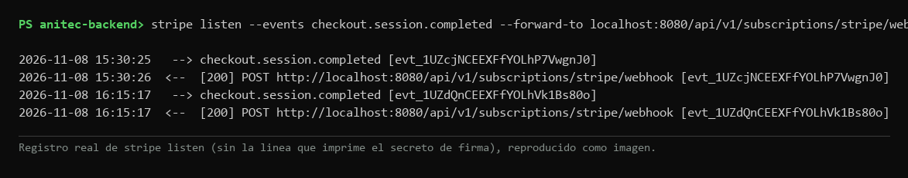
  <p><i><b>Fuente</b>: Salida de consola reproducida de <code>stripe listen</code> con los eventos del pago y las respuestas del servicio; no es una captura de pantalla.</i></p>
</div>

<div align="center">
  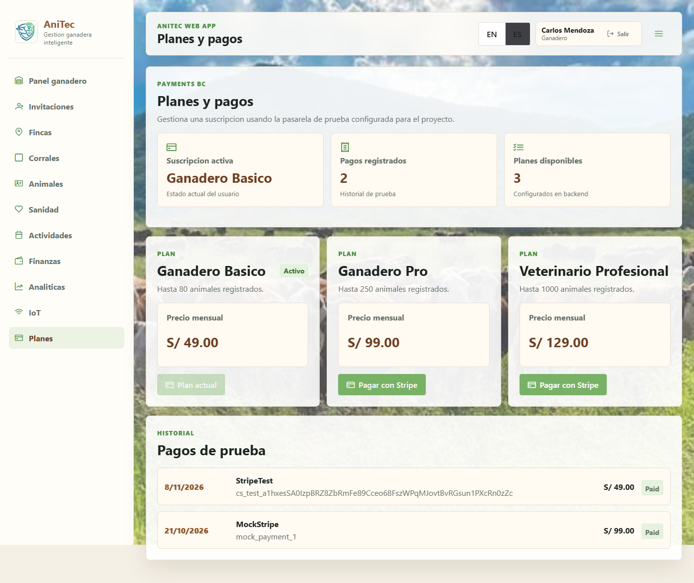
  <p><i><b>Fuente</b>: Captura de pantalla de la página de planes tras el pago real: suscripción activa e historial con el pago.</i></p>
</div>

### Verificación en Azure

El entorno de Azure (sección 5.3.3.6) se verificó el 08/11/2026 sin autenticación y el 12/11/2026 con un pago de prueba real.

- **Sin autenticación (08/11/2026):** `/health` respondió 200; `/gateway/status` mostró `api1`, `api2` y `subscriptions` en `Healthy` (confirma que el gateway llega por HTTPS interno a las dos apps); sin token, `/api/v1/herds` respondió 401; la versión `/api/v2/...` respondió 400; el webhook sin firma y con firma falsa respondió 400; el `X-Correlation-Id` enviado volvió igual; y un inicio de sesión inválido llegó hasta la base de Aiven y respondió `InvalidCredentials` (400).
- **Pago real (12/11/2026):** con el frontend ejecutándose en la máquina del desarrollador y apuntando al gateway de Azure, se pagó el plan Ganadero Pro (PEN 99,00) con la tarjeta de prueba de Stripe. La página mostró "Payment confirmed", los planes mostraron la suscripción activa y el historial un pago `Paid`. Los registros de `ca-subscriptions` muestran las consultas de idempotencia y **un solo** `INSERT` en `subscriptions` y otro en `payments`.
- **Webhook en Azure:** el panel de Stripe registró dos intentos de `checkout.session.completed` a las 21:13:23 y 21:13:37 UTC (hora de Stripe) que el servicio rechazó con **400 "Invalid webhook signature"**. Por eso, el pago quedó registrado esa vez por el endpoint de respaldo `confirm`, no por el webhook. Se investigó: el secreto cargado en Azure era idéntico al del destino de Stripe, el mismo código y el mismo secreto aceptaban un evento firmado en local, pero un evento firmado por el desarrollador era rechazado en Azure. Se añadió el registro del motivo de rechazo (`85ce35d`), se reconstruyó la imagen de Subscriptions y se desplegó una revisión nueva (`diag-1620`); con ella, un evento firmado fue aceptado. **La causa del rechazo anterior no quedó demostrada**; la hipótesis es que la réplica que arrancó el 08/11 tenía un valor anterior del secreto, sin verificar. A las 21:30:10 UTC se reenvió desde Stripe el mismo evento: Azure respondió **200** con `{"received":true,"handled":true,"duplicate":true}`, que demuestra la verificación de la firma y la idempotencia con un evento real.

<div align="center">
  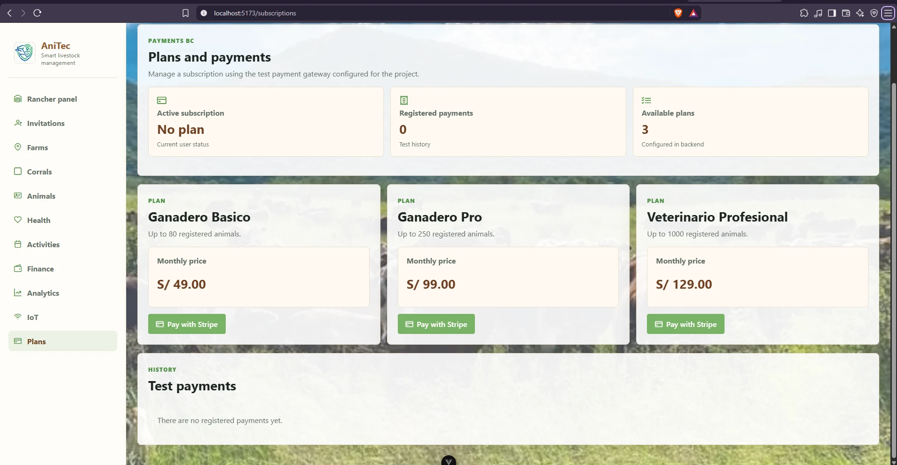
  <p><i><b>Fuente</b>: Captura de pantalla del frontend local apuntando al gateway de Azure, antes del pago: sin plan activo y sin pagos.</i></p>
</div>

<div align="center">
  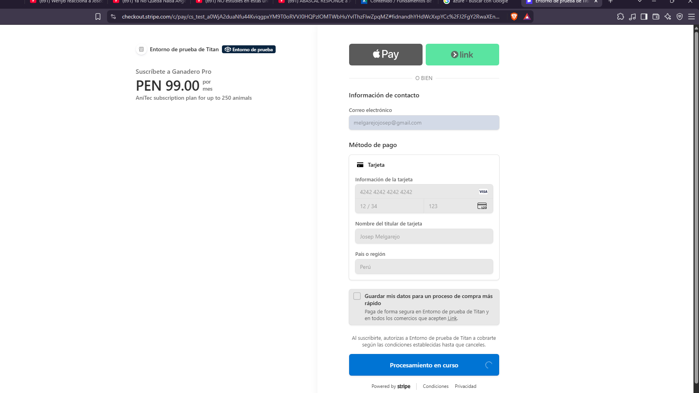
  <p><i><b>Fuente</b>: Página de pago alojada por Stripe (entorno de prueba) para el plan Ganadero Pro, PEN 99,00 por mes.</i></p>
</div>

<div align="center">
  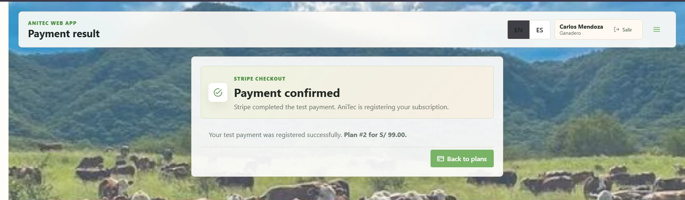
  <p><i><b>Fuente</b>: Página de éxito del frontend tras el pago contra el gateway de Azure.</i></p>
</div>

<div align="center">
  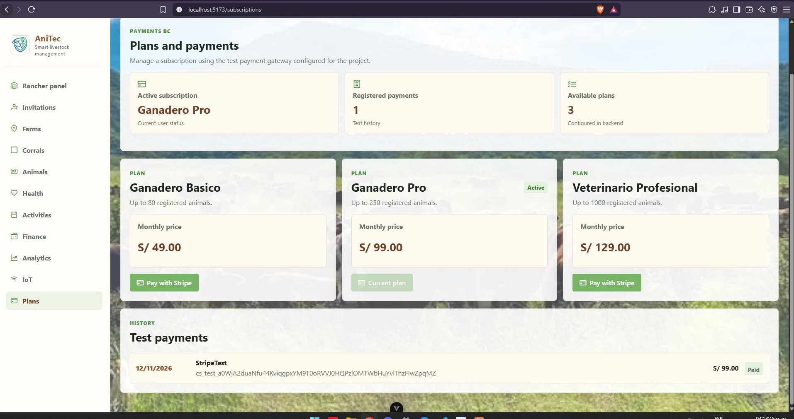
  <p><i><b>Fuente</b>: Captura de pantalla tras el pago: Ganadero Pro como suscripción activa y un pago en el historial.</i></p>
</div>

<div align="center">
  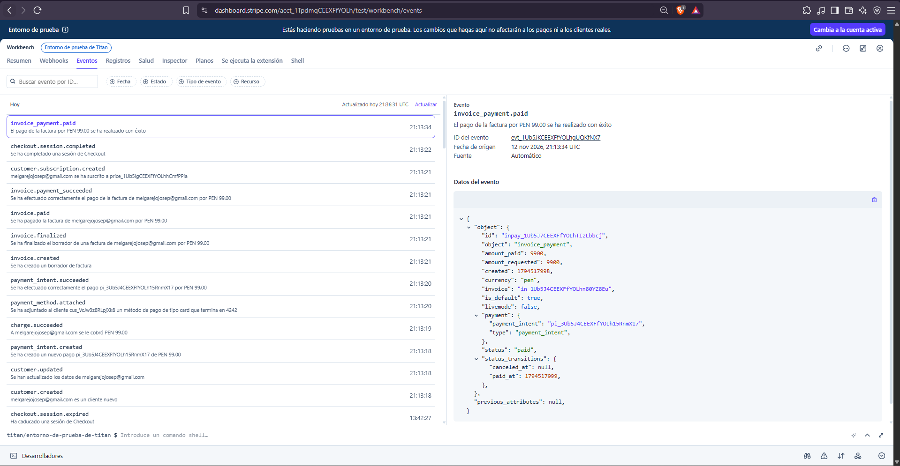
  <p><i><b>Fuente</b>: Panel de Stripe (Workbench, entorno de prueba): eventos generados por el pago, desde la creación del cliente hasta <code>invoice_payment.paid</code>.</i></p>
</div>

<div align="center">
  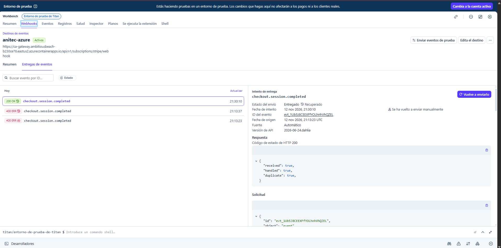
  <p><i><b>Fuente</b>: Panel de Stripe: destino <code>anitec-azure</code> con los dos intentos fallidos (400) y la reentrega manual con 200 y <code>duplicate: true</code>.</i></p>
</div>

### Copia de datos de suscripciones

El script `scripts/subscriptions-cutover/copy-subscriptions-data.sh` copia los planes, las suscripciones y los pagos de la base del núcleo a la base de Subscriptions, comprueba antes que no haya valores repetidos que los índices únicos rechazarían ni referencias huérfanas, y verifica filas y suma de control después de copiar. Se ejecutó **solo contra el MySQL local de Compose con datos de demostración** (3 planes, 3 suscripciones y 3 pagos); **no se ejecutó contra Aiven ni contra Azure**. La base de Aiven tiene tres planes, tres suscripciones y tres pagos legados que se copiarían en ese caso.

<div align="center">
  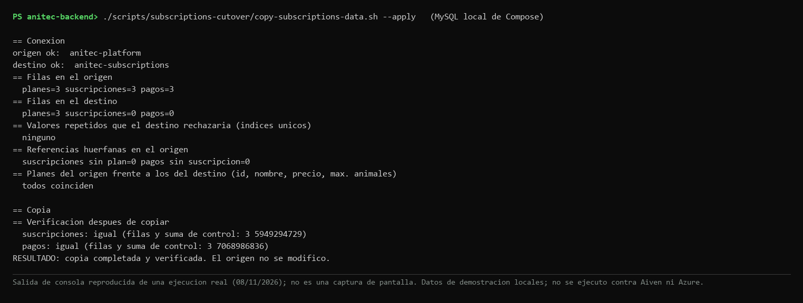
  <p><i><b>Fuente</b>: Salida de consola reproducida de una ejecución real del script en el MySQL local de Compose; no es una captura de pantalla.</i></p>
</div>

**Enlace al video de demostración del Sprint 3:** <!-- PLACEHOLDER: reemplazar por la URL del video (YouTube) que muestre el entorno con gateway, el aislamiento del servicio de suscripciones y el pago de prueba --> `https://youtu.be/xxxxxxxxxxx`

### Diagramas de los cambios del Sprint

Solo se muestran los fragmentos que cambian en este Sprint.

<div align="center">
  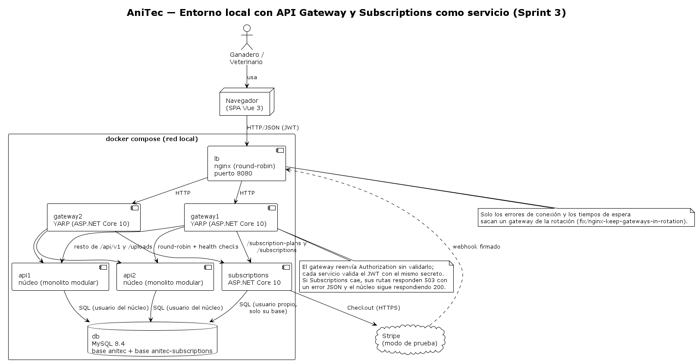
  <p><i><b>Fuente</b>: <code>CodeDiagrams/5-3-3-sprint-3/compose-gateway-topology.puml</code>.</i></p>
</div>

<div align="center">
  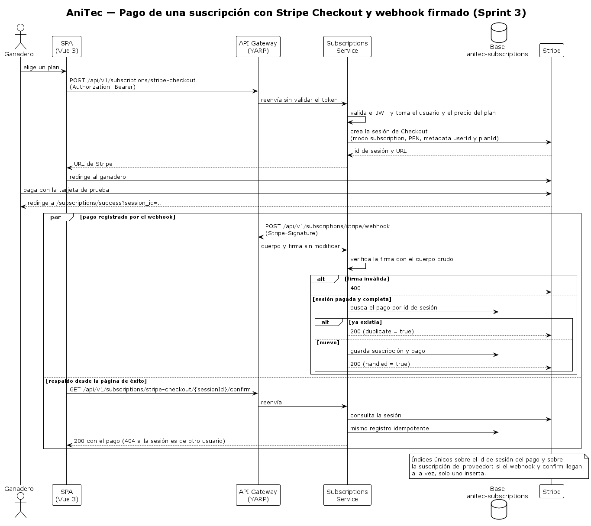
  <p><i><b>Fuente</b>: <code>CodeDiagrams/5-3-3-sprint-3/sequence-stripe-checkout.puml</code>.</i></p>
</div>

## 5.3.3.5. Microservices Documentation Evidence for Sprint Review

Cada servicio documenta sus endpoints con OpenAPI mediante Swashbuckle. El Swagger de Subscriptions lo publica el propio servicio (en `/swagger` mientras corre en `Development`) y **no está agregado al del núcleo**, que sigue con el suyo. La tabla incluye los endpoints creados o modificados en este Sprint.

| Método y ruta | Rol / autenticación | Descripción | Respuestas |
|---|---|---|---|
| `GET /api/v1/subscription-plans` | Rancher o Veterinarian (JWT) | Lista los planes (tres, sembrados por migración: 49, 99 y 129 PEN) con su límite de animales. Ruta atendida por Subscriptions. | 200, 401, 403 |
| `GET /api/v1/subscription-plans/{id}` | Rancher o Veterinarian | Un plan por id. | 200, 404 |
| `GET /api/v1/subscriptions` | Rancher o Veterinarian | Lista **solo las suscripciones del usuario** autenticado. | 200, 401 |
| `GET /api/v1/subscriptions/{id}` | Rancher o Veterinarian | Una suscripción propia; 404 si es de otro usuario (QAS-08). | 200, 404 |
| `GET /api/v1/subscriptions/users/{userId}/active` | Rancher o Veterinarian | Suscripción activa del propio usuario; 404 si el id no es el suyo o no tiene una. | 200, 404 |
| `GET /api/v1/subscriptions/users/{userId}/payments` | Rancher o Veterinarian | Historial de pagos del propio usuario; 404 si el id no es el suyo. | 200, 404 |
| `POST /api/v1/subscriptions/stripe-checkout` | Rancher o Veterinarian | Crea la sesión de Stripe Checkout (modo `subscription`, moneda PEN) con el precio del plan; el comprador es el del token. Devuelve el id y la URL de la sesión. | 200, 401, 404, 503 |
| `GET /api/v1/subscriptions/stripe-checkout/{sessionId}/confirm` | Rancher o Veterinarian (solo quien abrió la sesión) | Respaldo de la página de éxito: registra la sesión si el webhook no llegó y devuelve lo ya guardado en otro caso; exige sesión completa y pagada. | 200, 400, 401, 404 |
| `POST /api/v1/subscriptions/stripe/webhook` | Anónimo; firma `Stripe-Signature` | Recibe los eventos de Stripe. Solo actúa sobre eventos con firma válida; un pago confirmado crea la suscripción y el pago una sola vez. | 200, 400 |
| `POST`, `PUT`, `DELETE` en planes y suscripciones y `POST /api/v1/subscriptions/mock-checkout` | Solo en `Development` | Ayudas de demostración. Fuera de Development responden 404. | 200, 201, 404 |
| `GET /health` (cada servicio y el gateway) | Sin autenticación | Comprobación de salud usada por Docker, nginx y Azure. | 200 |
| `GET /gateway/status` | Solo si `Gateway__ExposeStatus` es `true` | Estado de salud (activa y pasiva) de cada destino de cada clúster. | 200, 404 |
| Cualquier ruta bajo `/api/v2/...` | — | El gateway responde un error 400 documentado para una versión de API no soportada y no enruta. | 400 |

### Contrato del gateway

| Ruta del cliente | Destino | Notas |
|---|---|---|
| `/api/v1/subscription-plans/**`, `/api/v1/subscriptions/**` (incluye el webhook) | Servicio de suscripciones | El cuerpo, `Stripe-Signature` y `Authorization` llegan sin modificar. |
| `/api/v1/**`, `/uploads/**` | Núcleo (`api1`, `api2`) | Reparto por turnos con comprobaciones de salud activas y pasivas. |
| `/health`, `/gateway/status` | El propio gateway | `/gateway/status` está apagado salvo que se active por configuración. |

Comportamientos del gateway: genera un `X-Correlation-Id` si falta y lo conserva si el cliente envía uno bien formado (uno mal formado se reemplaza); si un servicio no responde devuelve un problema JSON que nombra el servicio (`"The 'subscriptions' service did not answer. Other services keep working."`, abreviado) con 502 o 503 y el identificador de correlación; si ningún destino del clúster está sano responde 503 de inmediato; maneja CORS una sola vez y quita la cabecera `Origin` antes de reenviar para que los servicios no añadan una segunda `Access-Control-Allow-Origin`.

### Ejemplos de petición y respuesta

**Recibir un evento de Stripe con firma válida (Azure, evento reenviado desde el panel de Stripe).**

```http
POST /api/v1/subscriptions/stripe/webhook
Stripe-Signature: t=...,v1=...
Content-Type: application/json
```

```json
{ "received": true, "handled": true, "duplicate": true }
```

**Recibir un evento con firma inválida.**

```json
{ "message": "Invalid webhook signature." }
```

**Consultar la suscripción activa de otro usuario.** Con el token de un usuario y el id de otro, la respuesta es 404, igual que si no existiera: el servicio no revela que el recurso existe.

<div align="center">
  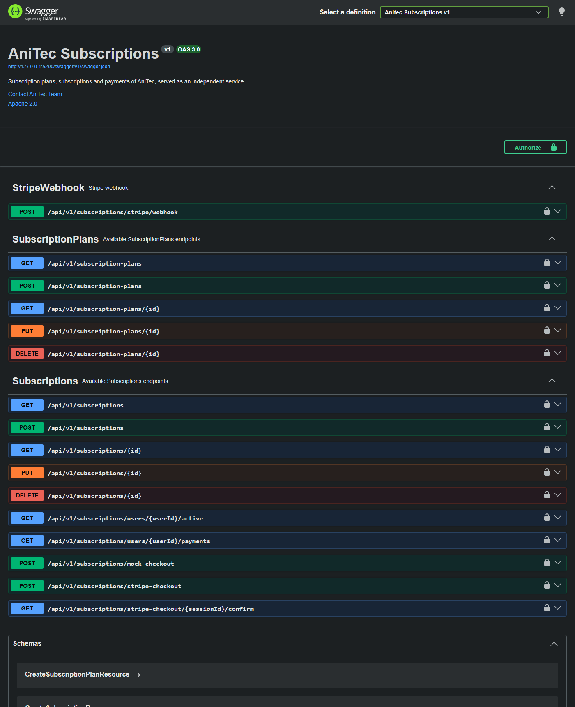
  <p><i><b>Fuente</b>: Captura de pantalla del Swagger del servicio de suscripciones ejecutado de forma independiente en local, en modo <code>Development</code>: por eso aparecen también los endpoints que solo existen en Development (creación y edición de planes y suscripciones y <code>mock-checkout</code>). El candado es el esquema Bearer global de Swagger; el webhook es anónimo y se autentica con la firma.</i></p>
</div>

## 5.3.3.6. Software Deployment Evidence for Sprint Review

El Sprint entrega dos despliegues: el entorno local reproducible con Docker Compose, actualizado con el gateway y el servicio de suscripciones, y el despliegue en **Azure Container Apps**. **No se actualizó el despliegue de producción en Render ni en Aiven**, ni se republicaron el frontend y la landing page.

### Entorno local con Docker Compose

| Elemento | Detalle |
|---|---|
| Orquestación | `docker-compose.yml` en la raíz de `anitec-backend`. |
| Servicios | `db` (MySQL 8.4), `db-init` (crea la base y el usuario de Subscriptions de forma idempotente), `api1` y `api2` (núcleo), `subscriptions`, `gateway1` y `gateway2` (YARP) y `lb` (nginx). |
| Balanceo | nginx reparte entre los dos gateways con `proxy_connect_timeout 2s` y `proxy_next_upstream error timeout`; cada gateway reparte entre las dos réplicas del núcleo y envía las rutas de suscripciones al servicio. |
| Datos | Una base por servicio con usuario propio; el usuario de Subscriptions no tiene acceso a la base del núcleo. |
| Configuración | Variables en `.env` (copiado de `.env.example`, que no contiene secretos; el archivo `.env` no se versiona). Las claves de Stripe pueden quedar vacías: el servicio responde que Stripe no está configurado. |

```bash
cp .env.example .env
docker compose up --build
curl -i http://localhost:8080/health
```

### Despliegue en Azure

El despliegue lo ejecuta el script `deploy/azure/deploy.sh` desde un Git Bash con `az` autenticado. Lee los secretos del archivo `deploy/azure/.secrets.env` (ignorado por Git; solo se versiona una plantilla sin valores) y los carga como secretos de Azure; no imprime ningún valor.

| Recurso | Detalle |
|---|---|
| Suscripción | Azure for Students (crédito de USD 100, vence el 06/04/2027). La política de la suscripción solo permite cinco regiones (mexicocentral, chilecentral, canadacentral, northcentralus y eastus2). |
| Grupo de recursos | `rg-anitec-sprint3`, East US 2. |
| Container Apps Environment | `cae-anitec-sprint3`, plan Consumo; registros en Log Analytics (`log-anitec-sprint3`, tope de 0,5 GB al día). |
| `ca-gateway` | YARP, ingreso externo HTTPS, de 1 a 2 réplicas de 0,25 CPU y 0,5 GiB. Es el único con URL pública. |
| `ca-core` | Núcleo, ingreso interno, 2 réplicas fijas de 0,5 CPU y 1 GiB; usa la base de Aiven. |
| `ca-subscriptions` | Servicio de suscripciones, ingreso interno, 1 réplica de 0,25 CPU y 0,5 GiB; claves de Stripe como secretos de Azure. |
| Registro de imágenes | `acranitecd188d9`, Azure Container Registry Basic; las imágenes se construyen con el Docker local para `linux/amd64`. |
| Base de Subscriptions | Azure Database for MySQL, servidor flexible `mysql-anitec-d188d9` (Burstable B1ms, MySQL 8.4, 20 GB, sin alta disponibilidad), en **Mexico Central**; base `anitec-subscriptions` y usuario propio. Acceso público limitado a servicios de Azure y TLS obligatorio. |
| Base del núcleo | La base real de Aiven (MySQL gratuito) a través de TLS; el núcleo en Azure aplicaría las migraciones al arrancar, y se comprobó antes que las 10 migraciones aplicadas en Aiven son las mismas 10 del código, sin pendientes. |
| Secretos | JWT compartido, claves de Stripe, secreto del webhook y cadenas de conexión: secretos de Azure, nunca variables visibles. |

Pasos (cada subcomando es independiente y se ejecutó por separado):

```bash
bash deploy/azure/deploy.sh smoke      # grupo de recursos, Log Analytics y entorno de Container Apps
bash deploy/azure/deploy.sh infra      # registro de imágenes y servidor MySQL
bash deploy/azure/deploy.sh images     # construye y sube las tres imágenes
bash deploy/azure/deploy.sh database   # base y usuario de Subscriptions
bash deploy/azure/deploy.sh apps       # las tres Container Apps
bash deploy/azure/deploy.sh webhook    # carga el secreto del webhook de Stripe
bash deploy/azure/deploy.sh status     # URL del gateway y salud del sistema
```

El webhook se configuró en el panel de Stripe (Workbench, modo de prueba) como un destino llamado `anitec-azure` hacia `https://<gateway>/api/v1/subscriptions/stripe/webhook`, con los eventos `checkout.session.completed` y `checkout.session.async_payment_succeeded`; su secreto de firma se guardó en el archivo de secretos y `deploy.sh webhook` lo cargó en Azure.

**Decisiones y hallazgos del despliegue.**

- **eastus2 no ofrece MySQL para esta suscripción.** El primer intento de crear el servidor falló con "No available SKUs in this location". Se consultaron los SKUs de las cinco regiones permitidas: solo Mexico Central y Chile Central ofrecen servidores flexibles de MySQL. Se creó el servidor en Mexico Central y las apps quedaron en East US 2; la latencia entre Subscriptions y su base, que ahora cruza regiones, **no se midió**.
- **HTTPS interno entre apps.** El gateway llega al núcleo y a Subscriptions por sus direcciones internas HTTPS; `/gateway/status` mostró los tres destinos en `Healthy`, lo que lo verificó (era una duda abierta).
- **El primer arranque del webhook falló con 400** y se resolvió con una revisión nueva (ver 5.3.3.4); la causa no quedó demostrada.
- **Las imágenes subidas por los usuarios no se comparten ni persisten.** Se guardan en el disco de cada contenedor; resolverlo requiere Azure Files o almacenamiento de objetos, fuera del alcance de este Sprint.
- **Aiven gratuito se retira el 21/12/2026.** La base real del núcleo está en un servicio gratuito de Aiven que su proveedor retira en esa fecha. El proyecto se entrega antes, pero la migración de la base del núcleo a Azure Database for MySQL queda como seguimiento y no se hizo en este Sprint.

**Costo.** En los primeros tres días (08/11 a 12/11/2026) el grupo de recursos consumió **USD 6,10** del crédito (de USD 100 quedaban USD 89 en el portal): `ca-core` USD 2,69, MySQL USD 1,49, `ca-gateway` y `ca-subscriptions` USD 0,67 cada uno, registro de imágenes USD 0,58 y Log Analytics USD 0,00. Es un ritmo de entre USD 1,5 y USD 2 al día (estimación a partir de esos tres días) mientras los recursos sigan encendidos. Los recursos se mantienen para la evaluación y se borrarán con `deploy.sh destroy` al terminar, que pide confirmación escrita.

<div align="center">
  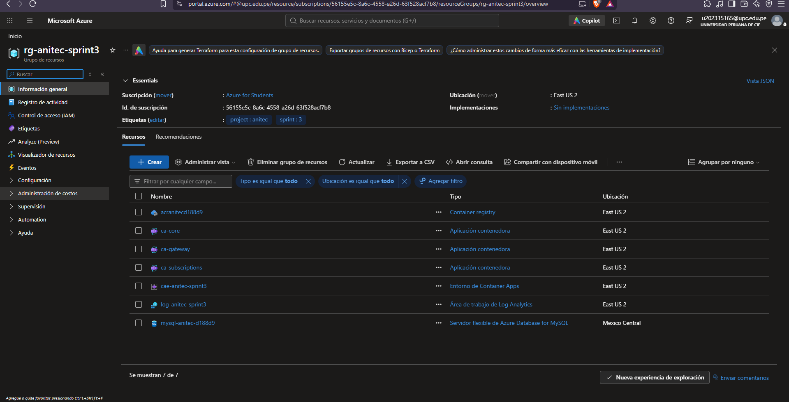
  <p><i><b>Fuente</b>: Portal de Azure: los siete recursos del grupo <code>rg-anitec-sprint3</code> (registro de imágenes, tres Container Apps, el entorno, Log Analytics y el servidor MySQL en Mexico Central).</i></p>
</div>

<div align="center">
  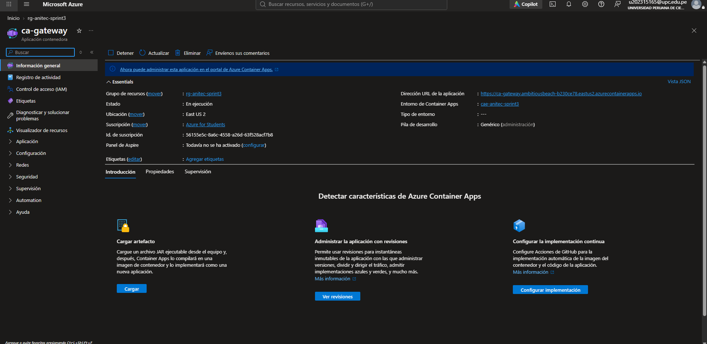
  <p><i><b>Fuente</b>: Portal de Azure: <code>ca-gateway</code> en ejecución, con su URL pública.</i></p>
</div>

<div align="center">
  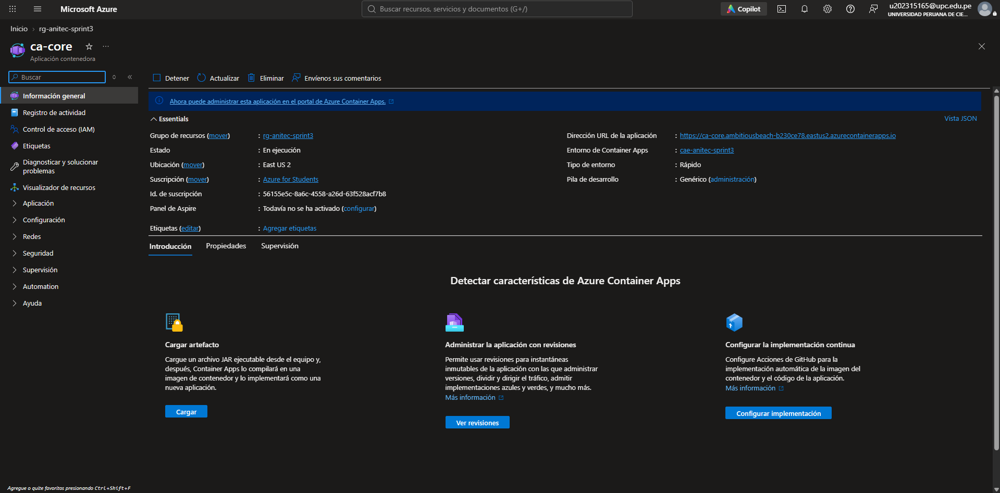
  <p><i><b>Fuente</b>: Portal de Azure: <code>ca-core</code> en ejecución. La captura no muestra el número de réplicas.</i></p>
</div>

<div align="center">
  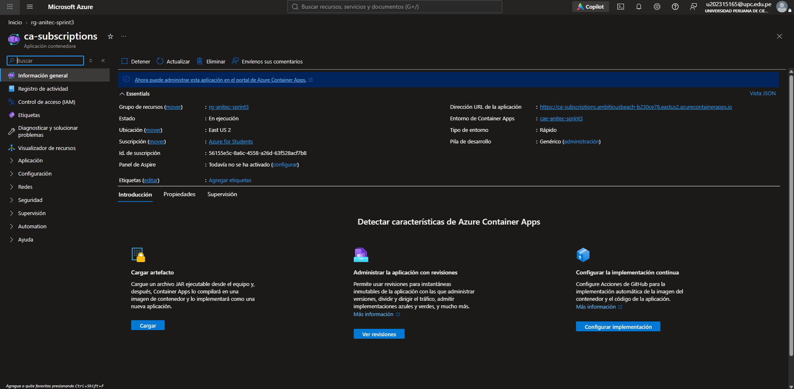
  <p><i><b>Fuente</b>: Portal de Azure: <code>ca-subscriptions</code> en ejecución.</i></p>
</div>

<div align="center">
  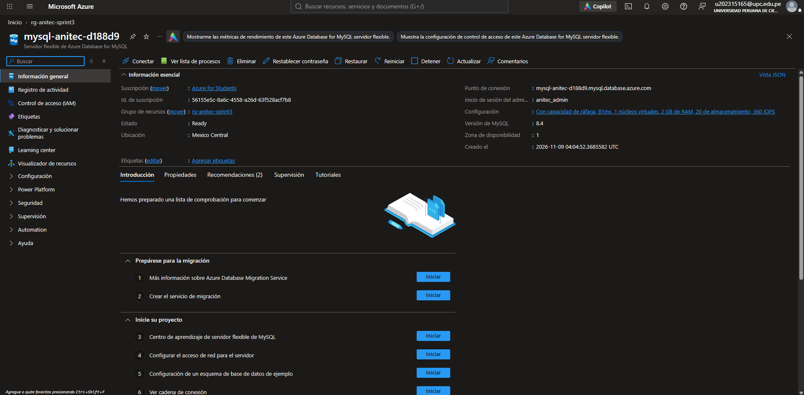
  <p><i><b>Fuente</b>: Portal de Azure: servidor <code>mysql-anitec-d188d9</code>, estado Ready, MySQL 8.4, Burstable B1ms, en Mexico Central.</i></p>
</div>

<div align="center">
  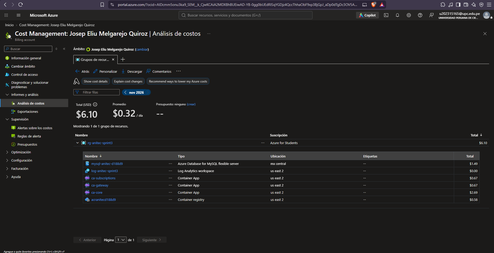
  <p><i><b>Fuente</b>: Portal de Azure, Cost Management: costo de noviembre por recurso (USD 6,10 al 12/11/2026).</i></p>
</div>

<div align="center">
  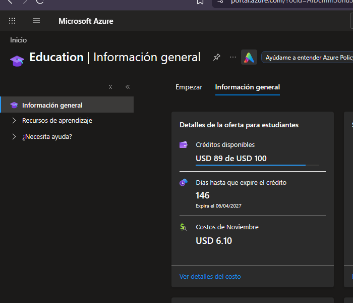
  <p><i><b>Fuente</b>: Portal de Azure, oferta para estudiantes: USD 89 disponibles de USD 100.</i></p>
</div>

<div align="center">
  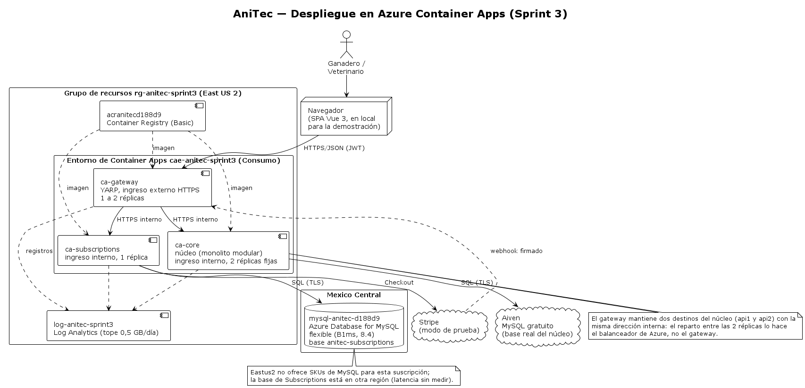
  <p><i><b>Fuente</b>: <code>CodeDiagrams/5-3-3-sprint-3/azure-container-apps.puml</code>.</i></p>
</div>

### Integración continua

El flujo `.github/workflows/ci.yml` compila la solución, ejecuta las pruebas de los tres proyectos contra un servicio MySQL descartable y construye las tres imágenes de Docker. No usa secretos y no publica nada. **Está escrito y su sintaxis se revisó, pero aún no se ejecutó en GitHub**: su primera ejecución ocurrirá cuando el equipo suba las ramas.

## 5.3.3.8. Kanban Board --> Avance 4

<div align="center">
  <!-- PLACEHOLDER: captura del tablero Kanban del Sprint 3 en Trello al cierre del Sprint -->
  <p><i><b>Fuente</b>: Tablero del Sprint 3 en Trello (captura pendiente de agregar por el equipo al cierre del Sprint).</i></p>
</div>

**Revisión del objetivo:** el objetivo del Sprint se cumplió en el entorno local y en Azure. Subscriptions corre como un servicio independiente con su propia base de datos, el gateway enruta y aísla las fallas (60 de 60 peticiones al núcleo respondieron 200 con el servicio detenido), y un pago real de prueba con Stripe se registró de punta a punta con el webhook firmado, con la verificación de la firma en Azure y la idempotencia confirmadas. Quedan pendientes llevar el frontend y la landing page a producción, ejecutar el flujo de CI en GitHub, el despliegue del núcleo y de su base fuera de Aiven y las brechas listadas en 5.3.3.1.

**Lecciones aprendidas:**

- La verificación de punta a punta encontró en el gateway y en el balanceador cuatro defectos que ninguna de las 297 pruebas de servicio detectó (nginx sacando los gateways de la rotación, la espera de 4 a 7 s, la resolución de nombres de nginx y la falta de reintento). Conviene mantener el recorrido automatizado, como se hizo con `verify_stack.py`, y correrlo en cada cambio de infraestructura.
- Las pruebas pasaron en local sin detectar que el webhook de Azure rechazaba las firmas; solo un pago real contra el entorno desplegado lo mostró. Registrar el motivo de los rechazos de seguridad, sin exponer el secreto, habría acortado el diagnóstico.
- Los supuestos sobre la nube se confirman antes de depender de ellos: la región elegida no ofrecía el servicio de base de datos y la política de la suscripción limitaba las regiones; ambas cosas solo aparecieron al ejecutar el despliegue.
- Extraer un servicio reveló defectos del código heredado (condición de `confirm`, `mock-checkout` con usuario del cuerpo, planes editables por cualquier rol) que no estaban en el backlog; conviene revisar el código del contexto antes de extraerlo.
- Mantener el secreto compartido del JWT fuera del repositorio, de las capturas y del chat exige disciplina: se resolvió con archivos ignorados por Git, secretos de Azure y scripts que nunca imprimen valores.
