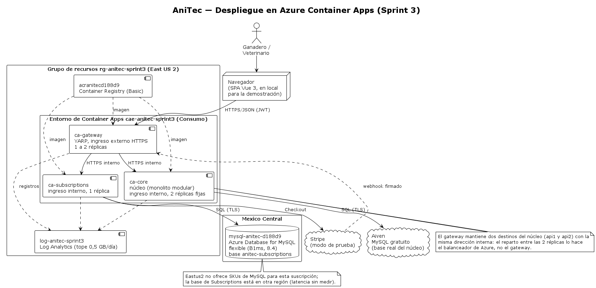

# 5.4. MicroServices Deployment

Esta sección documenta cómo se despliegan los servicios de AniTec en la nube. En el Sprint 3 se hizo el primer despliegue en **Microsoft Azure**: el API Gateway, el núcleo y el servicio de suscripciones corren en Azure Container Apps y la base de datos del servicio de suscripciones está en Azure Database for MySQL. El estado descrito es el del 12/11/2026; lo que no se ejecutó se marca como diseñado.

## 5.4.1. Cloud Architecture Diagrams

El diagrama muestra los recursos de Azure y su relación con Stripe y con la base real del núcleo, que sigue en Aiven. El código fuente del diagrama está en `CodeDiagrams/5-3-3-sprint-3/azure-container-apps.puml`.

  
  
<i><b>Fuente</b>: <code>CodeDiagrams/5-3-3-sprint-3/azure-container-apps.puml</code>.</i>

**Correspondencia entre el entorno local y Azure.**

| Entorno local (Docker Compose) | Azure | Observación |
|---|---|---|
| `lb` (nginx) delante de dos gateways | Ingreso externo HTTPS de `ca-gateway` | Azure termina el HTTPS y reparte entre las réplicas del gateway; no hay nginx. |
| `gateway1` y `gateway2` (YARP) | `ca-gateway`, de 1 a 2 réplicas | Mismo programa y misma configuración de rutas. |
| `api1` y `api2` (núcleo) | `ca-core`, 2 réplicas fijas | El gateway mantiene dos destinos con la misma dirección interna; el reparto lo hace el balanceador de Azure. |
| `subscriptions` | `ca-subscriptions`, 1 réplica | Ingreso interno: solo el gateway llega a él. |
| MySQL 8.4 con dos bases | Azure Database for MySQL (solo Subscriptions) y Aiven (núcleo) | Dos bases en dos proveedores. |
| `.env` con las claves | Secretos de Azure | Ninguna clave aparece como variable visible ni en el repositorio. |
| `docker compose logs` | Log Analytics (`log-anitec-sprint3`) | Con tope diario de 0,5 GB. |

## 5.4.2. Cloud Architecture Deployment

**Proveedor y recursos.** Azure for Students, región East US 2 para las apps y Mexico Central para MySQL (East US 2 no ofrece servidores flexibles de MySQL para esta suscripción; sección 5.3.3.6). Recursos del grupo `rg-anitec-sprint3`: entorno de Container Apps `cae-anitec-sprint3` (plan Consumo), tres Container Apps (`ca-gateway` con ingreso externo; `ca-core` y `ca-subscriptions` con ingreso interno), registro de imágenes `acranitecd188d9` (Basic), espacio de Log Analytics y el servidor MySQL `mysql-anitec-d188d9` (Burstable B1ms, 8.4).

**Automatización.** Un solo script versionado, `anitec-backend/deploy/azure/deploy.sh`, crea y configura todo con subcomandos independientes (`smoke`, `infra`, `images`, `database`, `apps`, `webhook`, `status` y `destroy`). Es idempotente donde importa (la creación de la base y del usuario de Subscriptions) y su borrado exige escribir el nombre del grupo. Los secretos salen de un archivo local ignorado por Git y se cargan como secretos de Azure; el script no imprime ningún valor. No es infraestructura como código declarativa (no hay Bicep ni Terraform): es un guion imperativo de la CLI de Azure.

**Qué se verificó y qué no.**

| Verificado el 08/11 y el 12/11/2026 | No verificado |
|---|---|
| El gateway responde `/health` con 200 y `/gateway/status` muestra el núcleo y Subscriptions sanos por HTTPS interno. | La latencia de Subscriptions hacia su base, ahora en otra región. |
| Sin token, `/api/v1/herds` responde 401; `/api/v2/...` responde 400; el webhook sin firma o con firma falsa responde 400. | El comportamiento con varias réplicas del gateway bajo carga (solo se usó una). |
| El núcleo llega a la base de Aiven por TLS (un inicio de sesión inválido responde 400 `InvalidCredentials`). | Un recorrido autenticado completo sobre el núcleo en Azure con los scripts de verificación (usan cuentas del entorno de desarrollo). |
| Un pago real de prueba (plan Ganadero Pro, PEN 99,00) desde el frontend en local hacia el gateway de Azure dejó la suscripción activa y un pago `Paid`; los registros muestran un solo `INSERT` por tabla. | La copia de los datos legados de suscripciones a Azure (el script solo se ejecutó en local). |
| El destino de webhook `anitec-azure` en Stripe recibió un evento real y Azure respondió 200 con `duplicate: true` tras la reentrega. | El cobro con otros medios de pago de Stripe; solo se probó la tarjeta de prueba. |

**Costo y duración.** Entre el 08/11 y el 12/11/2026 el grupo consumió USD 6,10 de los USD 100 del crédito (ritmo de entre USD 1,5 y 2 al día, estimado). Los recursos permanecen encendidos para la evaluación y se eliminarán con `deploy.sh destroy yes-delete-rg-anitec-sprint3` al terminar.

**Seguimientos.**

- **Migrar la base del núcleo.** El núcleo en Azure usa la base de Aiven, cuyo plan gratuito se retira el 21/12/2026. La migración a Azure Database for MySQL no se hizo en este Sprint.
- **Imágenes subidas por los usuarios.** Se guardan en el disco de cada contenedor y no se comparten entre réplicas ni sobreviven a un reinicio; requiere almacenamiento de objetos o Azure Files (hallazgo R6).
- **Alertas y observabilidad.** Las alertas de costos, el registro estructurado y el seguimiento distribuido corresponden al Sprint 4 (iteración 7).
- **Despliegue continuo.** El flujo de GitHub Actions compila, prueba y construye las imágenes, pero no publica ni despliega; el despliegue en Azure es manual.
